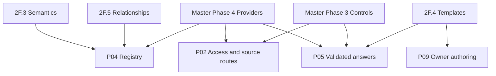
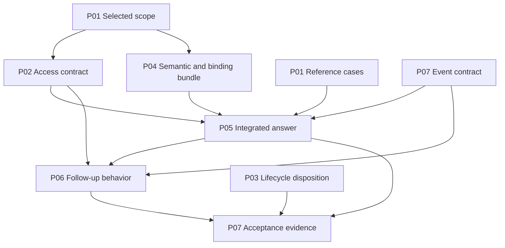

# AskTD / AskAlpha — Delivery Plans and Master Plan Lineage

**Document ID:** ASKTD-PLAN-LINEAGE-REF  
**Version:** 0.4  
**Prepared:** 21 October 2026, America/Toronto  
**Updated:** 22 October 2026, America/Toronto  
**Package edition:** 23 October 2026; portable references only. The proposed mapping, version and substantive decisions are unchanged.  
**Language:** English  
**Purpose:** Give GitHub Copilot a self-contained reference for generating coherent planning artifacts, with traceability from the Master Plan to engineering phases, delivery plans, named outputs, tasks, evidence and releases.  
**Status:** Owner-requested planning reference. The delivery crosswalk is proposed until reconciled with the operative repository records. This file does not establish implementation, merge, deployment, approval or release status.

## 1. How to use this reference

Read this file together with the current repository Master Plan, applicable instructions, active task records, ADRs and existing issue/PR evidence. Preserve existing task identities and later accepted decisions. Use this reference to organize work; do not restart the project or treat a new document as evidence that an implementation is missing.

This reference consolidates the earlier P01–P15 portfolio, the English v0.2 guide, the subsequent phase-mapping clarification and the owner's SQL/Databricks requirement. It fills the missing full Master-to-Plan crosswalk. It does not silently replace the operative Master Plan or rewrite accepted history. [SRC-MASTER, SRC-PORTFOLIO, SRC-GUIDE, OWNER-2026-10-21]

### 1.1 Evidence and authority

- The original reviewed Master basis is **MASTER_PLAN_V1(2).md, revision 2.0 proposed, 19 October 2026**. The same working copy receives a **revision 2.1 proposed continuity amendment, 22 October 2026**, preserving the original sections and adding the provider/Plan/session mapping. Neither revision establishes adoption in the application. The intended operative filename remains the existing MASTER_PLAN_V1.md at its actual application documentation path.
- That Master copy preserves original engineering Phases 0–7, the detailed 2F sequence and product releases R1–R4. It explicitly does not establish the current private application HEAD or deployment.
- The reference author did not verify the current private repository task/PR state. Copilot must reconcile actual repository evidence before assigning status or instantiating duplicate work.
- Apply current explicit owner decisions and applicable approvals within their scope. Record conflicts with existing task authority or later source revisions. Resolve the affected conflict without blocking unrelated planning work.
- A newer date alone is not proof that a document supersedes an accepted decision. Record revision, status, scope and adoption evidence.
- Source references in this document identify provenance. They are not all accessible from Copilot automatically. Locate the operative equivalents and record any unavailable source.

### 1.2 Keep these classifications separate

| Classification | Meaning |
|---|---|
| Master-derived requirement | A requirement or phase scope explicitly appears in the cited Master section |
| Proposed delivery mapping | This reference associates that requirement with a P01–P15 outcome |
| Retained baseline | Existing work/evidence must be preserved and reused where valid |
| Owner-directed refinement | The 21 October direction changes the baseline delivery allocation |
| Unresolved repository anchor | The actual task, PR, file, symbol or test has not yet been reconciled |

A row can have more than one classification. For example, SQL/Databricks support is a Master-derived capability, while its allocation across the early Plans reflects the newer owner refinement.

Keep three kinds of status independently:

1. **Artifact state:** draft, reviewed, adopted or superseded.
2. **Work state:** the repository's actual backlog/in-progress/completed state.
3. **Evidence maturity:** unknown, designed, implemented, verified or qualified for a named scope.

Creating a Plan issue changes artifact availability; it does not prove implementation or operational qualification.

### 1.3 Continuation entry point and repository roles

Start baseline reconciliation with the [Session Handoff](ASKTD_SESSION_HANDOFF.md) and [Continuation Prompt](ASKTD_NEW_SESSION_PROMPT.md). They record the documentation checkpoint, historical reports, unavailable evidence and next bounded activity. This reference remains the detailed Plan/output/lineage specification.

| Source group | Role | Limit |
|---|---|---|
| Documents in this package | Product, proposed Master, portfolio, lineage, English guide and task templates with their revision history | Their presence does not establish application changes or operative Master adoption |
| Application repository and intended GitHub Project | Sources for code, operative Master, Tasks, PRs and deployment evidence | Resolve actual identities, HEAD, PR state, deployed revision and Plan/Task mappings during repository reconciliation |
| Historical application evidence | Retained reports of accepted work and earlier validation | Preserve evidence within its dated scope; reverify only when the current task or a regression requires it |

The historical application handoff, summarized in the [Session Handoff](ASKTD_SESSION_HANDOFF.md), reports successful login and App Service SQL SAMI validation. Locate its original application evidence during repository reconciliation; reopen the investigation only when current evidence justifies it. The 22 October application-repository access attempt returned 404 through the available connection. This does not establish deletion, regression or failure.

The [Copilot generation prompt](ASKTD_COPILOT_ARTIFACT_GENERATION_PROMPT.md) is an execution template. Reading it during baseline reconciliation does not authorize its embedded task. The task must be explicitly requested in the intended application workspace. The continuation prompt starts with read-only reconciliation. [SRC-HANDOFF, SRC-HISTORICAL-HANDOFF]

## 2. Product context for a new participant

AskTD, also called AskAlpha in product documents, is a conversational analytics application for approved business data. The first business focus is Deposits. An authorized user asks a business question, the application resolves approved meaning and access, executes a bounded analysis, and presents a supported answer with its context. [SRC-MASTER §§2–3]

Example: an authorized user asks for the month-end deposit balance in Region A for September compared with August. A supported answer must use the approved balance definition, reporting dates, units, permitted region and source. The follow-up “Break it down by product” needs an approved relationship and a new access check. Any illustrative values are examples, not business acceptance evidence.

The target request flow is:

1. Validate sign-in and resolve current application permissions.
2. Understand the question and clarify missing or ambiguous meaning.
3. Resolve approved metric, recipe, dataset, relationship and version references.
4. Select an allowed source binding and validate the analysis.
5. Execute a bounded, read-only query through the qualified provider adapter.
6. Validate the result, preserve numbers and meaning, and present its source/as-of context.
7. Support bounded follow-ups and record safe operational evidence.

### 2.1 Terms

| Term | Meaning |
|---|---|
| Registry | The application's versioned runtime catalog of approved definitions and references; it is not a copy of all business data |
| Metric / KPI | An approved business measure, with calculation, units, grain and reporting rules |
| Recipe | An approved reusable analytical method with controlled inputs and dependencies |
| Source binding | Mapping from logical definitions to qualified physical objects/fields in a named provider and environment |
| Adapter | The component that applies the source's connection, dialect, validation, execution and result-conversion rules |
| Analytical plan | The structured analysis for one user request |
| Delivery Plan | A project work package, such as P04, with a defined deliverable and acceptance |
| Engineering phase | An existing Master engineering identifier, such as 2F.3 |
| Release | A scoped product delivery with explicit acceptance; it is distinct from engineering-phase closure |
| Lineage | The recorded reason a requirement, output, task, PR, evidence item or release is connected to another |

## 3. The planning model and lineage rules

### 3.1 One project, several views

| View | Question answered | Example |
|---|---|---|
| Master requirement | Why is this needed? | Approved and versioned business meaning |
| Engineering phase | Which existing engineering scope does it belong to? | 2F.3 certified semantic catalog |
| Delivery Plan | Who owns the complete delivery outcome? | P04 Registry and approved relationships |
| Named output | What specific artifact or behavior is supplied? | P04.semantic_bundle |
| Task | What bounded action will be performed? | Add the approved metric definition and validate its mapping |
| Evidence | What demonstrates the claim, at which revision and scope? | Review, test result, reference comparison or environment observation |
| Release | Where will the accepted output be used? | R1 selected pilot workflow |

P01–P15 are delivery identifiers introduced by this planning exercise. They are not Master phase numbers. P04 and Master Phase 4 describe different things.

The relationship is many-to-many:

- P04 consumes work from 2F.3 and, when needed, 2F.5, while retaining distinct slice identities.
- 2F.4 contributes to P05 runtime presentation and P09 owner authoring.
- P02 draws on identity, authorization and provider qualification across Master Phases 1, 3 and 4.
- An existing task has one canonical identity. Link it to all relevant requirements instead of creating copies for every phase, Plan or release.
- Prefer one accountable Plan parent for a Task. Record contributing Plans and engineering references as links. If a Task contains unrelated outputs, split it by deliverable using repository conventions.

### 3.2 Relationship types

| Relationship | Meaning | Is it a scheduling blocker? |
|---|---|---|
| derived_from | A Plan/output is justified by a requirement or owner decision | No |
| belongs_to | A Task/output has an accountable Plan or existing phase association | No |
| implements | A Task/change realizes a named output | Not by itself |
| requires_output | A consumer activity requires a specific producer output | Yes, for that activity when unmet |
| shares_contract | Two parties must agree on an interface or policy contract | Contract agreement is required; do not create whole-Plan reciprocal blockers |
| accepted_by | Evidence/decision is required to accept an enabled capability | Acceptance gate, distinct from permission to do preparatory design |
| evidenced_by | A claim is supported by a test/review/observation | No |
| contributes_to_release | An output is selected for a release scope | No |
| supersedes | A dated, accepted change replaces a specified earlier requirement or decision | No; record exact scope and authority |

The diagrams below are views of this model. The dependency register, not visual position or numbering, determines execution prerequisites.



**Diagram meaning:** arrows show proposed lineage/contribution, not whole-Plan completion dependencies. The same phase can supply more than one Plan.

### 3.3 Identity and numbering

- Preserve original Master Phases 0–7. Later handoffs sometimes call provider integration Phase 3, while the Master calls it Phase 4. Retain both source namespaces until actual task anchors are reconciled. Do not rename branches or accepted tasks.
- Keep 2F.3 semantic certification and 2F.5 relationship evidence separate even though both contribute to P04.
- Keep proposed 2F.1a conditional and 2G provisional. Neither is proof of an instantiated or completed task.
- Historical relationship prerequisites D4–D6 are a different namespace from September architecture deltas D04–D06.
- Output keys such as P04.bindings are stable planning aliases within this reference, not new repository task numbers.
- Reuse existing repository IDs. If no corresponding ID exists, use the repository's normal allocation convention and record the P alias.

### 3.4 Executive presentation namespace

The executive onepager introduces a separate presentation grouping. Keep its namespace with the number. [SRC-EXECUTIVE]

| Executive phase | Release grouping | Delivery contribution |
|---|---|---|
| Executive 1 — Governed Foundation and Deposits Pilot | Readiness and R1 | Selected P01–P07 outputs |
| Executive 2 — Everyday Use and Recurring Value | R2 and R3 | P08–P10, conditional P11, P12/P13 and supporting controls |
| Executive 3 — Management Reporting and Controlled Expansion | R4 and approved further expansion | P14 and conditional P15, with applicable supporting outputs |

Executive Phase 3, Master Phase 3, a later provider Phase 3 alias and Delivery Plan P03 are distinct references. The onepager's proposed calendar does not create a delivery commitment or engineering completion claim.

### 3.5 Earlier portfolio aliases

The v0.1 portfolio used **D — Deliverable** for the relationship now called **H — Required output**. The meaning remains a scoped prerequisite; this is a planning-schema transition, not a new task or a change to actual repository IDs. Its updated v0.2 copy retains the historical aliases and a transition table.

| Earlier planning alias | Current reference counterpart |
|---|---|
| P01.references | P01.reference_cases |
| P01.acceptance | P01.acceptance_owners plus the selected acceptance/gate records |
| P02.contract | P02.scope_contract and the relevant separately owned execution contracts |
| P02.qualification | Applicable P02.sql_route/P02.databricks_route, P02.enforcement_evidence and P07.provider_readiness |
| P03.decision | P03.policy_decision |
| P03.policy | P03.selected_enforcement where adopted |
| P03.disposition | P03.lifecycle_disposition |
| P04.semantic | P04.semantic_bundle |
| P04.relationships | P04.relationship_evidence |
| P04.versions | P04.publication_contract with the relevant binding/version references |
| P05.result | P05.result_contract |
| P05.presentation | P05.curated_templates and applicable result/presentation behavior |
| P05.evidence | P05.correctness_evidence and separately scoped control evidence |
| P06.context | P06.context_contract and P06.followup_behavior |
| P06.evidence | P06.context_evidence |
| P07.contract | P07.event_contract and applicable metering/support contracts |
| P07.measurements | P07.metering and provider-readiness observations |
| P07.packet | P07.acceptance_bundle |
| P08.saved-analysis | P08.saved_analysis |

Some mappings are one-to-many. Reconcile the actual deliverable and evidence before linking; do not apply a global rename or create a second issue because its alias changed. New generated records use this reference's named outputs. [SRC-PORTFOLIO]

## 4. Master Plan crosswalk

The Master phase scopes in this section are documented in SRC-MASTER §9.1. The P-plan associations are proposed delivery mappings. Read supporting relationships as relevant scope contributions, not a requirement to complete all future work in each phase.

### 4.1 Broad engineering phases

| Master phase | Principal Plan relationships | Retained scope and delivery treatment |
|---|---|---|
| 0 — Secure foundation and governance | Retained baseline supporting P02/P07 | Reuse accepted login, protected-route, security, test and rollback evidence; reopen only a demonstrated current defect |
| 1 — IAM, SpruceX and deployment alignment | P02; P07 qualification/ownership evidence | Identity/registration, groups, workload grants, networking, environment boundaries and build/run ownership |
| 2 — Registry and semantic foundation | P03, P04, P05, P09 | Existing foundation, actual 2F slices, approved definitions, provenance, templates and controlled publication |
| 3 — Authorization, audit, quality and safe execution | P02, P05, P06, P07; applicable controls follow P08/P11/P12/P14 | Current access, row/column treatment, safe execution, business evaluation, model payloads, renderer and cache isolation |
| 4 — SQL Server and Databricks scale | Baseline P02/P04/P05/P07; P15 further expansion | Provider bindings/adapters, identity/dialect behavior, execution bounds, freshness, concurrency and qualification |
| 5 — Model governance, usage and observability | P07/P10; relevant P05 model boundaries | Actual-call inventory, policy, metering, attribution, tracing, showback and later approved chargeback |
| 6 — Governed self-service | P09; related P04/P13/P15 outputs | Owner authoring, controlled publication, reviewed improvement, later metadata administration/onboarding |
| 7 — Operations and adoption | P07 and operational requirements of every released Plan | Monitoring, support, SLOs, recovery, release/rollback, retention, capacity and cost/value evidence |

Minimum Phase 3, 5 and 7 controls must accompany the pilot. Their broader phase labels are not a reason to postpone necessary access, monitoring or support until the end. [SRC-MASTER §§9.1, 10–12]

### 4.2 Detailed 2F and publication references

| Engineering slice | Delivery relationship | Boundary |
|---|---|---|
| 2F.1 lifecycle classification | Retained baseline used by P03 | Preserve trace-only classification and valid repairs/evidence; no duplicate classifier implementation |
| 2F.1a proposed bounded error hardening | P05, evidence through P07 | Verify existing authority, current need and later completion before adding work |
| 2F.2 approval/reapproval policy | P03 | Accountable policy decisions precede selected new enforcement; missing timestamps do not invent expiry |
| 2F.3 certified semantic catalog | P04 semantic slice; P01 business inputs | Approved meaning, ownership, provenance, versions, recipe references and intake contract |
| 2F.4 governed templates | P05 runtime/output contracts; P09 authoring | Keep curated runtime templates, owner UI, persistence, richer rendering and exports in bounded tasks |
| 2F.5 evidence-backed relationships | Distinct P04 relationship slice | Approved endpoints, keys, cardinality, grain/time and aggregation evidence; no guessed joins |
| 2F.6 relevant hardening/additional recipes | Owning Plan of each actual gap | Reuse existing guards; add only missing evidence or justified corrections |
| 2G publication forward reference | Minimal P04/P05 publication; P09 author workflow | Provisional label until linked to the actual repository definition |

Source: SRC-MASTER §9.2. Full new 2F.2 enforcement is not a universal R1 prerequisite: the accepted lifecycle disposition and A06 evidence are required for the selected scope.

### 4.3 Product capabilities without one unique historical subphase

| Plan | Explicit Master anchor | Engineering placement |
|---|---|---|
| P01 | §§3.1, 9.3 readiness, 10.1 A01/A04 | Cross-cutting business scope/acceptance; reconcile actual task |
| P06 | §§3.5, 4.3, 9.3 R1 | Session/clarification capability with applicable Phase 3 controls; precise task anchor unresolved |
| P08 | §§3.5, 9.3 R2 | Saved work/history/preferences; precise task anchor unresolved |
| P11 | §7.4 | Conditional reuse; applicable isolation/provider controls; precise task anchor unresolved |
| P12 | §§3.6, 9.3 R3, 11 | Scheduling/delivery capability; precise task anchor unresolved |
| P13 | §§3.7, 9.3 R3 | Suggestions and reviewed improvement; precise task anchor unresolved |
| P14 | §§3.1, 9.3 R4, 11 export requirements | Reporting/export capability; precise task anchor unresolved |

Do not manufacture new phase numbers to make these rows look complete.

## 5. SQL and Databricks baseline

Master Phase 4 already names SQL Server and Databricks. The owner's 21 October direction makes compatible Registry and application-access behavior for both provider families an explicit baseline obligation. The former broad association of provider phases only with P15 is insufficient. [SRC-MASTER §9.1; SRC-PORTFOLIO phase table; OWNER-2026-10-21]

The revised allocation is:

- P01 defines provider coverage and comparable reference fixtures.
- P02 defines common logical application permissions and qualified enforcement/connectivity per provider.
- P04 defines shared logical semantics with explicit versioned SQL and Databricks bindings.
- P05 validates execution and a common result contract through each supported adapter.
- P07 records evidence separately for every provider/environment.
- P15 covers expansion beyond that required baseline.

### 5.1 Common meaning, provider-specific implementation

Keep metric identity, approved calculation, units, grain, time interpretation, logical permissions and result meaning consistent. Bindings/adapters handle physical objects, types, dialect, precision, parameters, connection, native privileges, errors, timeouts and cancellation.

Databricks also executes SQL. Here, “SQL route” means the specifically selected and qualified SQL-family endpoint. Qualifying one SQL Server/Azure SQL/Synapse mode does not qualify all of them. Name the exact product and execution mode.

Equal KPI names do not prove equivalent datasets. Compare controlled fixtures or data whose grain, dates, treatment and freshness are demonstrably comparable.

Supporting both providers does not authorize cross-provider joins. Cross-provider analysis requires a separately approved scope and evidence.

### 5.2 Application authorization and workload identity

Preserve the owner's **App Service SQL system-assigned Managed Identity** direction. Preserve application-enforced effective human-user scope. Qualify the selected Databricks managed-identity route for the actual host, connector, token flow, supported versions, workspace and source privileges; do not assume identical connection settings or silently substitute another identity.

Application permissions do not replace native database/Unity Catalog grants. A workload identity does not automatically carry each human user's restrictions. Do not require continuous copying of every provider's end-user ACL into the application. Use approved entitlement authority, trusted inputs and explicit revocation behavior. [SRC-AUTH; SRC-MASTER §§7, 12]

Required restrictions apply before protected retrieval/aggregation and before any protected payload reaches a model. Provider changes, fallback routes, preferences, templates, subscriptions and budget decisions cannot widen access.

### 5.3 Staged qualification

One provider route may be qualified first for an explicitly scoped pilot. That result does not close the other provider's baseline obligation.

Maintain separate SQL and Databricks records for Registry binding, access enforcement, adapter behavior, workload connection, business correctness and support. Missing live access can leave environment qualification pending while authorized design or synthetic verification continues.

## 6. Delivery portfolio

All Plans below define intended outcomes. Their current implementation status is **unreconciled** until the connected session maps existing evidence. Names may be retained as aliases when the repository already has canonical Plan IDs.

| Plan | Outcome | First intended product scope |
|---|---|---|
| P01 | Pilot scope and reference answers | Readiness / R1 |
| P02 | Application access and qualified source routes | R1 baseline, extended with every protected feature |
| P03 | Recipe approval/reapproval policy and lifecycle disposition | Required disposition for selected scope; new enforcement conditional |
| P04 | Registry and approved relationships for both providers | R1 selected question bundle |
| P05 | Validated answers through both execution routes | R1 |
| P06 | Clarification and bounded session follow-ups | R1 |
| P07 | Monitoring, support, metering and acceptance evidence | R1 minimum, extended per release |
| P08 | Saved work and explicit preferences | R2 |
| P09 | Owner templates and controlled publication | R2 |
| P10 | Usage administration, showback and budgets | R2; scheduled-work controls in R3 |
| P11 | Authorized analytical reuse | Conditional, when measurement justifies it |
| P12 | Scheduled reports and secure subscriptions | R3 |
| P13 | Contextual suggestions and reviewed improvement | R3 |
| P14 | Management reports and controlled exports | R4 |
| P15 | Additional source and metadata expansion | Conditional expansion beyond the baseline |

### 6.1 P01 — Pilot scope and reference answers

**Outcome:** Business, engineering and quality teams agree on one bounded analytical product.

**Lineage:** SRC-MASTER §§3.1, 9.3, 10.1; D01/D10; A01/A04. Cross-cutting readiness work; no invented phase. Provider coverage also reflects OWNER-2026-10-21.

**Named outputs:** P01.scope, P01.reference_cases, P01.provider_coverage, P01.acceptance_owners.

**Work:** Select questions, personas, objects, approved metrics, dimensions, units, grain, dates, follow-up depth, output expectations and acceptance owners. Start with one representative complete question. The historical 10–15-question target remains subject to agreement. Define which questions apply to SQL, Databricks or both and the comparable fixtures.

**Inputs:** Operative Master and existing business decisions; source feasibility from P02 and semantic definition work with P04.

**Acceptance:** Every selected case has an approved method and expected outcome, permitted scope, freshness/tolerance where needed, unsupported cases and reviewer. Illustrative numbers are not approved reference answers.

**Lead:** Product/semantics, with business/data owners and QA. Broad domain discovery and unapproved delivery dates are outside the first slice.

### 6.2 P02 — Application access and qualified source routes

**Outcome:** The intended user/data scope is enforced on each supported provider route.

**Lineage:** SRC-MASTER §§7, 9.1 Phases 1/3/4, 10.1; D03/D04/D17; A02/A03. Retain Phase 0 foundation and existing SAMI work. Both-provider allocation reflects OWNER-2026-10-21.

**Named outputs:** P02.scope_contract, P02.sql_route, P02.databricks_route, P02.enforcement_evidence.

**Work:** Define logical resources, actions, row/dimension scope and column restrictions. Map these to qualified provider behavior. Record identity, native grants, network, connection and denial evidence separately. Preserve current login and proven guards.

**Inputs:** P01.scope/provider_coverage; approved grant authority and source treatment. Agree the logical resource/binding contract jointly with P04; this is not a circular completion dependency.

**Acceptance:** Allowed and denied paths, unresolved scope, revocation, missing workload grants and concurrent-user isolation have appropriate evidence. Changing provider cannot widen access or substitute an unqualified route.

**Lead:** Backend/integrations with IAM, platform/data owners and QA. Provider-user ACL replication and unrelated identity migration are excluded.

### 6.3 P03 — Recipe policy and lifecycle disposition

**Outcome:** Recipe approval/reapproval behavior is explicit, and the applicable release has an accepted lifecycle disposition.

**Lineage:** SRC-MASTER §§4.4, 6.3, 9.2, 10.1 A06; D07; retained 2F.1 and selected 2F.2.

**Named outputs:** P03.policy_decision, P03.lifecycle_disposition, P03.selected_enforcement.

**Work:** Establish accountable approval authority, valid evidence, acknowledgement, reapproval triggers and any explicitly required expiry/renewal. Keep trace-only classification separate from execution policy.

**Inputs:** Existing classifier/recipe evidence; actual policy owner decisions; semantic dependency identities agreed with P04.

**Acceptance:** Missing evidence is not invented expiry; unrelated Registry changes do not silently invalidate recipes. P03.selected_enforcement exists only when a new policy is selected. An accepted trace-only disposition may satisfy the scoped pilot's A06.

**Lead:** Engineering and content/approval-policy owner. Do not rebuild accepted 2F.1 or infer policy from a model.

### 6.4 P04 — Registry and approved relationships for both providers

**Outcome:** A published, versioned semantic/recipe bundle supports the selected questions on the required sources.

**Lineage:** SRC-MASTER §§6, 9.2; 2F.3 and distinct 2F.5; Master Phase 4 binding relationship; provisional publication reference; D02/D07/D10. Both-provider bindings reflect OWNER-2026-10-21.

**Named outputs:** P04.semantic_bundle, P04.bindings, P04.relationship_evidence, P04.publication_contract.

**Work:** Define stable logical IDs, approved metric meaning, datasets, fields, dimensions, recipes, units, grain, provenance and versions. Add explicit SQL/Databricks mappings. Keep semantic certification and relationship evidence separate. Define publication, retirement, rollback and compatibility.

**Inputs:** P01 definitions/reference cases, joint P02 scope/binding contract and applicable approval decisions. Approved manual intake can support a bounded scope when enterprise integration is unavailable.

**Acceptance:** Each binding preserves approved meaning and relevant type/precision/time rules. Required joins have endpoint, key, cardinality and aggregation evidence. Unsupported or ambiguous mappings fail safely. No assumed cross-provider join.

**Lead:** Product/semantics and engineering with business/data owners and QA. A competing enterprise catalog or mass onboarding is outside the first slice.

### 6.5 P05 — Validated answers through both execution routes

**Outcome:** An authorized question produces a correct, bounded, contextualized answer or a supported safe failure.

**Lineage:** SRC-MASTER §§4.3, 7, 8.2–8.3, 9.1–9.2; 2F.4 runtime contracts; justified 2F.1a/2F.6 only; Phases 3/4 and relevant model controls. D03/D05/D09/D10/D12/D15/D16/D17/D18.

**Named outputs:** P05.analysis_contract, P05.result_contract, P05.adapter_behavior, P05.curated_templates, P05.correctness_evidence.

**Work:** Integrate approved semantics/recipes, current permissions, provider-aware validation, bounded execution and explicit presentation. Preserve established frameworks and relevant model-helper boundaries.

**Inputs:** Selected P04 bundle/bindings, P02 scope/source contracts, P01 reference cases and P07 event contract. New P03 enforcement applies only to a route that adopts it.

**Acceptance:** Verify provider dialect/parameters/types/null/date behavior and execution bounds against comparable cases. The result preserves values, signs, units, periods, grain, user scope, warnings, versions, source/binding and freshness. Model-assisted presentation requires its own approved payload/behavior. Unsupported operations fail safely.

**Lead:** Backend and UX with semantics, QA and relevant model/security owners. Full authoring UI, scheduling and a new cache platform are outside this Plan.

### 6.6 P06 — Clarification and bounded session follow-ups

**Outcome:** Users refine an active analysis without losing approved meaning or bypassing current access.

**Lineage:** SRC-MASTER §§3.5, 4.3, 9.3 R1, 10.1; D05/D06/D18; applicable Phase 3 controls. Exact legacy task placement remains unresolved.

**Named outputs:** P06.context_contract, P06.followup_behavior, P06.context_evidence.

**Work:** Keep application-owned metric/recipe versions, periods, filters, units, grouping, source/binding references and clarification state. Handle topic changes and concurrent sessions.

**Inputs:** P04 identities, P05 analysis/result contracts, P02 current-access behavior and P07 event contract.

**Acceptance:** A follow-up retains only intended compatible context; ambiguous requests trigger clarification. Recheck current access before protected reuse or model transmission. No cross-user/session leakage or automatic retention of incompatible provider meaning.

**Lead:** UX/backend with product and QA. Persistent history and preferences belong to P08.

### 6.7 P07 — Monitoring, support, metering and acceptance evidence

**Outcome:** Each released scope is observable, supportable and measurable, with reviewable acceptance evidence.

**Lineage:** SRC-MASTER §§8, 9.1 Phases 3/5/7, 10–11; D10/D11/D12/D14/D17/D18. Provider-specific readiness reflects OWNER-2026-10-21.

**Named outputs:** P07.event_contract, P07.metering, P07.support_contract, P07.feedback, P07.provider_readiness, P07.acceptance_bundle.

**Work:** Define safe audit, trace and usage events early. Reuse the actual model-call inventory and qualified evidence. Record actual attempts and available costs, failure categories, support references, runbooks and accountable acceptance owners. Provide a safe way to report an inaccurate answer, with permitted answer/run correlation, controlled access and a clear review/support route; P07.feedback supplies that bounded feedback contract and evidence.

**Inputs:** P01 scope/acceptance owners and P02 access design for early contracts. Actual observations from P02/P05/P06 for integrated evidence. Applicable enterprise decisions remain explicit.

**Acceptance:** Distinguish design, implementation, adapter verification and environment qualification per provider. Missing metering is unknown, not zero. Targets come from the agreed workload. Record scope, exceptions and decision evidence.

**Lead:** QA/operations with engineering and relevant decision owners. Synthetic demonstration, pilot, Broad Beta and production are separate acceptance scopes.

### 6.8 P08 — Saved work and explicit preferences

**Lineage:** SRC-MASTER §§3.5, 9.3 R2; D06/D17/D18; applicable access and retention controls. No unique legacy subphase is asserted.

**Named outputs:** P08.saved_analysis, P08.history, P08.preferences.

Deliver these as three separable capabilities. A saved analysis stores valid references and parameters. History preserves permitted conversation/as-of context. Preferences are explicit, inspectable, editable and removable user choices.

**Inputs:** P02 current access, P04/P05 versioned definitions and P06 context where history requires it.

**Acceptance:** Reopening does not silently rerun queries or models; rerun is explicit and uses current access. Preferences cannot redefine meaning or grant access. Retention/deletion rules and source/binding compatibility are agreed.

**Lead:** UX/backend with product, privacy and data owners.

### 6.9 P09 — Owner templates and controlled publication

**Lineage:** SRC-MASTER §§3.4, 6.5, 9.1 Phase 6, 9.2 2F.4/provisional 2G, 9.3 R2; D02/D07/D09.

**Named outputs:** P09.authoring, P09.publication.

Let owners create parameterized questions and layouts from approved P04 definitions and P05 result/template contracts. Provide preview, independent review, versioned publication, retirement, rollback and disable behavior.

**Inputs:** P04 publication/semantic contracts, P05 presentation contracts, P02 author/approver permissions and P07 publication events.

**Acceptance:** Valid references, approved parameters and maker-checker rules remain intact. A template does not redefine a KPI or grant data access. Minimum curated publication is already in the P04/P05 scope; full authoring UI is not an R1 prerequisite.

**Lead:** Product/semantics and UX/backend with content approvers.

### 6.10 P10 — Usage administration, showback and budgets

**Lineage:** SRC-MASTER §8.5, §9.1 Phase 5, §9.3 R2/R3; D14 and relevant D11/D12.

**Named outputs:** P10.showback, P10.allowance_policy.

Use actual P07 metering to explain usage, estimates and agreed allowances. Include failures and retries; separate provider consumption from shared infrastructure and estimates from reconciled charges. Define applicable scheduled-work limits.

**Inputs:** P07 metering, P02 administrative access and accountable business/Finance decisions.

**Acceptance:** Reconciliation and attribution are explicit. A subscription does not grant business-data access. Budget behavior cannot weaken access or silently change provider/meaning. Formal chargeback has a separate Finance decision.

**Lead:** Product/operations and backend with Finance and service owners.

### 6.11 P11 — Authorized analytical reuse

**Lineage:** SRC-MASTER §7.4 and relevant Phase 3 isolation/Phase 4 provider behavior; D08. Conditional; no unique new subphase.

**Named outputs:** P11.reuse_policy, P11.reuse_evidence.

Introduce reuse when P07 measurements demonstrate value. Specify whether the cached item is a plan, bounded result or final response. Separate early lookup inputs from post-plan identity.

**Inputs:** P02 current scope; P04/P05 versions, source/binding identity and freshness; P07 measurements.

**Acceptance:** Prove eligibility, isolation, revocation and invalidation. An early key cannot require a semantic-plan hash that does not yet exist. Cache miss is not a lifecycle failure. No new cache platform is mandatory.

**Lead:** Backend with security, semantics and QA. This Plan is not a general R1 gate.

### 6.12 P12 — Scheduled reports and secure subscriptions

**Lineage:** SRC-MASTER §§3.6, 9.3 R3, 11 scheduled delivery; relevant Phases 3/5/7. No unique legacy subphase.

**Named outputs:** P12.schedule_contract, P12.run_delivery_evidence.

Run an approved saved analysis on a controlled schedule and initially deliver a secure link. Define owner/recipient/viewer authorization, time zones/DST, freshness, version compatibility, missed runs, retries, duplicate prevention, pause/cancel and owner departure.

**Inputs:** P08.saved_analysis or a qualified equivalent; valid published content; controlled P04/P05 source route; P02 access; P07 run/delivery evidence contract; required P10.allowance_policy.

**Acceptance:** Execution and viewing use current applicable access. Retry/resume cannot create unintended duplicate delivery. Each run records versions, scope, outcome, freshness and delivery evidence.

**Lead:** Backend/UX with operations and product. Full history, preferences, authoring UI and file export are not prerequisites.

### 6.13 P13 — Contextual suggestions and reviewed improvement

**Lineage:** SRC-MASTER §§3.7, 9.3 R3; relevant 2F.4 provenance and Phase 6 publication. Precise task anchor unresolved.

**Named outputs:** P13.authorized_suggestions, P13.improvement_proposals.

Use authorized catalog references, bounded context and safe aggregated feedback to suggest useful next analyses or reviewed content improvements.

**Inputs:** P04 approved catalog, P06 context and P02 access; P07.feedback for feedback-based improvement. P08.preferences is required only for preference-based suggestions. Use an accepted review/publication route for changes.

**Acceptance:** Showing a suggestion does not execute another query. Suggestions do not reveal another user's protected activity. Analytics cannot directly rewrite production definitions or permissions.

**Lead:** Product/semantics and UX/backend with content reviewers.

### 6.14 P14 — Management reports and controlled exports

**Lineage:** SRC-MASTER §§3.1, 9.3 R4, 11 export requirements; relevant Phase 3 audit/quality and Phase 7 operations. No unique legacy subphase.

**Named outputs:** P14.report_contract, P14.export_evidence.

Combine approved analyses into reports and permitted Excel/PDF outputs. Preserve provenance, compatible units/periods, scope, size bounds and analytical meaning.

**Inputs:** P04/P05 analyses, P02 export permissions and mandatory P07 audit/support. P12 is needed only for scheduled behavior.

**Acceptance:** Chat/report/export agree on numbers and meaning. Required audit exists before export. Distribution treatment is explicit; do not promise universal revocation of downloaded offline copies.

**Lead:** UX/backend with QA, product and data/security owners.

### 6.15 P15 — Additional source and metadata expansion

**Lineage:** SRC-MASTER §§3.2, 9.1 Phases 4/6, 9.3 conditional R4 expansion; D13 and selected D16. Scope boundary refined by OWNER-2026-10-21.

**Named outputs:** P15.expansion_decision, P15.qualified_extension.

Add a justified provider, source scope, business domain or enterprise metadata integration beyond the required SQL/Databricks baseline.

**Inputs:** Approved business case/scope, P02 access, P04 semantic/binding/publication contracts, P05 execution and P07 qualification evidence.

**Acceptance:** Each extension has specific semantics, identity, restrictions, execution, change-impact and operational evidence. Preserve the common contracts and state unsupported behavior.

**Lead:** Product and integrations with source/governance/operations owners. This does not authorize cross-provider joins, Genie or optional ingestion by default.

## 7. Output dependencies and parallel work

### 7.1 Dependency semantics

Use four explicit types:

- **H — Required output:** blocks the named consumer activity while the output is unmet.
- **C — Shared contract:** agreement is needed at the integration boundary; independent design can continue.
- **G — Acceptance gate:** blocks acceptance/activation of the applicable scope, not every preparatory activity.
- **O — Conditional:** the relationship applies only when the named feature/policy/route is selected; also record whether its effect is H, C or G.

For every dependency, retain producer, exact output, consumer/activity, type, applicability, satisfaction evidence and accountable role. Do not convert every related Plan into a native GitHub “blocked by” link.

A written contract alone does not satisfy a dependency on enforced runtime behavior. When instantiating the machine-readable register, resolve each named output to its relevant contract, implementation and evidence scope. Expand aggregate gate rows into the selected outputs and explicitly identified external decisions; do not invent task IDs for them.

### 7.2 Main dependency register

| ID | Producer/output | Consumer/activity | Type and condition |
|---|---|---|---|
| DEP01 | P01.scope and P01.provider_coverage | P02/P04 selected-scope qualification | H for final selected scope; feasibility/design can inform it |
| DEP02 | P01.reference_cases | P05 correctness checks; P07 A04 evidence | H for acceptance comparisons |
| DEP03 | P02.scope_contract with P04.bindings | Shared logical resource, policy and binding boundary | C; baseline jointly, then implement respective sides |
| DEP04 | P04.semantic_bundle and P04.bindings | P05 selected analysis integration | H for the selected metric/source only |
| DEP05 | P04.relationship_evidence | P05/P06 questions that require those relationships | H only for the relevant joins |
| DEP06 | Enforced P02.scope_contract; applicable P02.sql_route or P02.databricks_route | P05/P06 protected execution | H for enforced behavior; G for live route acceptance |
| DEP07 | P03.lifecycle_disposition | P07 scoped A06 acceptance | G; existing accepted trace-only mode can be a valid disposition |
| DEP08 | P03.selected_enforcement | P05 route adopting new policy | O-H/G; no blanket requirement for all pilot paths |
| DEP09 | P07.event_contract | P05/P06 instrumentation integration | C/H at integration; contract defined early |
| DEP10 | P05.analysis_contract and P05.result_contract | P06 follow-up integration | H for the integrated context contract |
| DEP11 | P02.enforcement_evidence, P05.correctness_evidence, P06.context_evidence | P07.provider_readiness and P07.acceptance_bundle | G for the applicable environment/scope |
| DEP12 | P07.acceptance_bundle, including required selected P01/P02/P04/P05/P06 evidence, P03.lifecycle_disposition and applicable external decisions | R1 selected operational-pilot decision | G; expand the selected A01–A10 evidence without requiring unrelated future scope |
| DEP13 | Enforced P02.scope_contract; valid P04.semantic_bundle/P04.bindings and P05.analysis_contract/P05.result_contract references | P08 protected saved work/history/preferences | H for protected behavior; retention/consent are applicable gates |
| DEP14 | P04.semantic_bundle/P04.publication_contract; P05.curated_templates/P05.result_contract | P09 owner authoring/publication | H for publishing valid content |
| DEP15 | P07.metering; administrative behavior under enforced P02.scope_contract | P10.showback and P10.allowance_policy | H; business/Finance decisions gate their applicable scope |
| DEP16 | P07.metering; P02.scope_contract, P04.semantic_bundle/P04.bindings and P05.result_contract scope/version/freshness | P11 reuse introduction and eligibility | O-H/G when reuse is selected |
| DEP17 | P08.saved_analysis or qualified equivalent | P12 persisted schedule definition | H; no dependency on completion of P08.history/preferences |
| DEP18 | Valid P04.semantic_bundle under P04.publication_contract; P04.bindings and qualified P05.adapter_behavior | P12 scheduled execution | H; full P09 authoring UI is not required |
| DEP19 | Owner/recipient/viewer behavior under enforced P02.scope_contract; P07.event_contract/P07.support_contract and required P10.allowance_policy | P12 safe run and delivery | H/G for enabled schedule scope |
| DEP20 | P04.semantic_bundle, P06.context_contract, enforced P02.scope_contract; P07.feedback for feedback-based improvement | P13 suggestions/improvement | H for the selected mode; feedback dependency applies to feedback-based improvement |
| DEP21 | P08.preferences | P13 preference-based suggestions | O-H only for that mode |
| DEP22 | Accepted route under P04.publication_contract, or qualified P09.publication | P13 adoption of an improvement | G; may use curated publication, not necessarily full P09 UI |
| DEP23 | P04.semantic_bundle/P04.bindings and P05.result_contract; export permission under enforced P02.scope_contract; audit under P07.event_contract | P14 reports/exports | H/G; implemented audit required before export |
| DEP24 | Implemented P12.schedule_contract and P12.run_delivery_evidence | P14 scheduled report/export behavior | O-H only if scheduled behavior is selected |
| DEP25 | P15.expansion_decision; scoped P02.scope_contract, P04.bindings/P04.publication_contract, P05.adapter_behavior and P07.provider_readiness | P15.qualified_extension | O-H/G for each separately selected extension |

Supporting relationships are not universal completion dependencies. For example, P02/P04 jointly design a binding contract without waiting for each other's entire Plan.



**Diagram meaning:** these are selected output dependencies. The early P07 contract and later P07 evidence are distinct outputs, so there is no circular requirement to complete P07 before P05 and P05 before P07. The complete release decision also needs the gates in Section 8.

### 7.3 Parallel work

P01 business definitions, P02 source/access contracts, P04 semantic design, applicable P03 decisions and P07 event contracts can progress together. P05/P06 can design bounded result/context contracts during that work. Assign ownership of shared contracts before concurrent edits.

A missing live Databricks connection blocks its environment qualification, not unrelated authorized SQL work or synthetic contract checks. A valid SQL result does not qualify Databricks. Do not use broader credentials or an unqualified source as silent fallback.

## 8. Releases and acceptance lineage

### 8.1 Product release mapping

| Milestone | Selected Plan outputs | User-visible outcome |
|---|---|---|
| Readiness | P01 and relevant P02/P04/P07 contracts | Agreed question, personas, owners, references, source coverage and demonstration scope |
| R1 — Trusted pilot | Required outputs of P01–P07; P03 disposition with enforcement only where selected | Correct bounded answers, tables/basic charts, clarification/follow-ups, feedback and support evidence |
| R2 — Everyday use | P08/P09/P10; P11 only if justified | Saved work/preferences, owner templates/publication, usage allowances |
| R3 — Recurring value | P12/P13 and required P10 budget behavior | Scheduled reports, secure delivery, suggestions and reviewed improvement |
| R4 — Management reporting | P14; P15 approved further expansion | Reports, controlled exports and justified expansion |

Source: SRC-MASTER §9.3, translated into delivery packages. The Master's 2027 calendar is a proposed executive mapping dependent on agreed start/capacity. Do not create due dates or commitments from it without current owner agreement. A release is not automatically a production approval.

### 8.2 Pilot gates A01–A10

All gates need scoped evidence. None is marked passed by this reference.

| Gate | Required evidence | Principal Plan contributions |
|---|---|---|
| A01 Scope and ownership | Approved questions, metrics, objects, personas, treatment and acceptance authority | P01; P02/P04 |
| A02 Effective access | Positive/negative enabled-path access and unresolved-scope behavior | P02; every enabled protected feature |
| A03 Governed source route | Endpoint, compute, identity, objects, treatment, freshness, connectivity and denial | P02/P04/P05; P07 records |
| A04 Business correctness | Approved reference calculations, expected results, snapshot/as-of, units/grain/tolerances | P01/P04/P05 |
| A05 Clarification | Safe ambiguity/unsupported handling across all enabled paths, including fast paths | P05/P06 |
| A06 Lifecycle compatibility | Applicable dependency/approval disposition and explicit limits; trace-only 2F.1 unless a separate change is accepted | P03/P04/P05 |
| A07 Presentation and payload | Numeric/semantic fidelity, warnings, source/as-of, approved model transmission | P05; relevant P06/P07 |
| A08 Model and evidence coverage | Actual enabled-call inventory, payload boundaries, context controls, safe correlation and durable or accepted interim evidence | P05/P06/P07 |
| A09 Operations and value | Workload, latency/concurrency/freshness, failure behavior, costs, manual-effort comparison and support | P07 with feature/source owners |
| A10 Scoped approval | Applicable privacy, data, architecture, security, MRM, pilot and operations decisions with conditions | Accountable authorities; P07 records references |

Source: SRC-MASTER §10.1. Plan owners gather evidence; they do not acquire enterprise approval authority merely by appearing in a table.

Broad Beta and production retain SRC-MASTER §§10.2–11 requirements. Activated history, reuse, scheduling, suggestions and exports need their own current-access, retention, freshness and failure evidence. A synthetic demonstration, passed CI job, merged PR or closed task does not itself satisfy release acceptance.

### 8.3 Provider readiness record

Use one record per capability, provider and environment:

| Field | Required content |
|---|---|
| Capability/output | Registry binding, access enforcement, adapter, connection, correctness or support output |
| Provider/environment | Exact SQL product/mode or Databricks route and named environment |
| Evidence maturity | Unknown / designed / implemented / verified / qualified |
| Scope | Named question/object/operation and relevant restrictions |
| Evidence | Actual reference, revision/artifact, observation date and verification method |
| Decision | Accountable acceptance owner, conditions and effective scope |
| Remaining gap | Exact missing evidence/decision; distinguish blocked from unsupported |

Designed does not imply implemented; implemented does not imply verified; a mocked adapter test does not imply a qualified live connection.

## 9. Architecture-delta coverage

This is proposed Plan coverage of the Master's Appendix B. Preserve the existing impact report's actual file/symbol/test anchors. Creating this table does not close a delta.

| Delta | Master anchor | Proposed delivery coverage |
|---|---|---|
| D01 Deposits-first MVP | §§2, 3, 10 | P01, supported by P05/P07 |
| D02 Runtime semantics/enterprise ownership | §6 | P04; governed references consumed by P05/P09 |
| D03 Authorization/MSI without ACL sync | §7 | P02 and every protected feature |
| D04 Governed route versus compute | §§4.2, 7.5, 13 | P02/P04/P05/P07 baseline; P15 further expansion |
| D05 Clarification | §§3.5, 4.3, 10 | P06 with P05 coverage across enabled routes |
| D06 Bounded context | §3.5 | P06 session; P08 persistent history/preferences |
| D07 Lifecycle/compatibility | §§4.4, 6.3, 9.2 | P03/P04 with retained 2F.1 |
| D08 Reuse before avoidable model work | §§4.3, 7.4 | P11, justified by P07 measurements |
| D09 Deterministic formatting | §§6.2, 8.3 | P05/P09 |
| D10 Pilot evaluation | §§8.3, 10 | P01/P05/P06/P07 |
| D11 Observability | §§8.1, 8.4 | P07 |
| D12 MRM/call inventory | §8.2 | P07 inventory/evidence and P05 model boundaries; external decision owner remains explicit |
| D13 Conditional integrations | §§3.2, 4.2, 9.1 | P15; preserve neutral P02/P04/P05 baseline interfaces |
| D14 Operating ownership/economics | §§8.4–8.5, 11, 13 | P07/P10 and feature-specific operations such as P12 |
| D15 Framework/gateway | §§4.2, 8.2 | P05 preserves established framework and qualifies relevant helpers; no implied migration |
| D16 Streaming/optional ingestion | §§3.2, 4.2 | P05 complete-response contract; P15 only for explicitly selected optional ingestion |
| D17 Protected API/storage roles | §§4.2–4.3, 8.1 | P02/P05 protected backend; P07 evidence stores; P08/P12 stores when enabled |
| D18 Payload/history qualification | §§3.5, 8.2–8.3, 14.2 | P05 input/error/result/output/renderer, P06 context, P08 history and P07 traces |

## 10. Task contract and worked lineage example

### 10.1 Required task fields

Each Task must identify: canonical ID; owning Plan; named output; Master revision/section/requirement; engineering namespace and phase/slice where established; mapping classification; target release/scope; bounded work; prerequisites; acceptance; implementation/review/decision roles; actual source context; provider/environment; evidence; existing-work disposition; and unresolved questions.

Use one primary engineering anchor when the task naturally has one and list supporting anchors separately. If no precise historical slice is established, record unresolved placement and the actual Master product requirement. Do not invent phase IDs.

Example YAML shape for a **proposed task definition**, not an executed task:

```yaml
schema_version: "1.0"
task_id: null
task_id_reason: "Allocate only after matching existing repository tasks"
plan_alias: P04
output_refs:
  - P04.semantic_bundle
master:
  document: MASTER_PLAN_V1
  reviewed_revision: "2.1 proposed"
  operative_revision: null
  sections: ["6.1", "9.2"]
  requirement_refs: [D02]
engineering:
  namespace: "Master original"
  primary_phase: "2F.3"
  supporting_phases: []
mapping_basis:
  - master-derived requirement
  - proposed delivery mapping
target_release: R1
scope: "One selected approved metric; exact metric pending scope reconciliation"
prerequisites:
  - output_ref: P01.reference_cases
    type: H
    blocks_activity: "Accept metric semantics against the business reference"
acceptance:
  - "The approved definition, units, grain, period and version are recorded"
  - "Actual evidence links support the scoped acceptance"
owner_role: "Product and semantics"
owner_login: null
reviewer_login: null
repository: null
source_revision: null
provider: null
environment: null
artifact_state: draft
work_state: null
evidence_maturity: unknown
existing_work_disposition: unresolved
evidence_refs: []
open_questions:
  - "Which existing task and metric definition already satisfy this scope?"
```

Null values are deliberate unresolved fields, not fabricated IDs or proof of missing implementation. Resolve necessary fields before promoting a Task to Ready.

### 10.2 Example question decomposed across Plans

| Required output | Plan | Engineering lineage | Example verification |
|---|---|---|---|
| Approved month-end balance meaning | P04, P01 business input | 2F.3 | Owner-approved reference definition and expected calculation |
| Required product relationship | P04 | 2F.5, if needed | Endpoint/key/cardinality/grain evidence |
| SQL and Databricks physical bindings | P04 | Semantic contract plus Master Phase 4 provider scope | Both bindings preserve the selected logical definition |
| Effective region restriction | P02 | Appropriate Phase 1/3/4 task anchors | Allowed/denied/revoked and concurrent-user cases |
| Correct bounded query and result | P05 | Phase 4 execution and Phase 3 safety; 2F.4 presentation | Provider-specific execution evidence and reference comparison |
| Safe follow-up | P06 | Master §3.5 and actual task anchor | Intended context retained; current access rechecked |
| Accepted operating scope | P07 | Applicable Phase 3/5/7 and A01–A10 | Provider/environment evidence and accountable scoped decision |

These are decomposition examples. Reuse existing tasks and evidence before creating any new task for them.

## 11. Artifacts Copilot should generate

Resolve the actual application root and current documentation conventions first. A possible location is docs/plans/asktd-delivery, but this is a suggested path, not an established repository location. Reuse equivalent existing artifacts instead of building a competing planning system.

| Artifact | Required contents |
|---|---|
| Planning index / README | Reading order, operative source references, Plan list, release view and links |
| Baseline reconciliation | Repo/root/branch/HEAD; relevant existing work; source versions; satisfied/partial/missing/unknown/superseded requirements; conflicts |
| Fifteen Plan documents | Fields from Section 6 plus actual source/task links, outputs, dependencies, acceptance and current evidence state |
| Lineage register | Master requirements/phases/deltas → Plans/outputs → actual Tasks/PRs → evidence → release scope, with mapping classifications |
| Dependency register and Mermaid views | Typed output-level relationships from Section 7; applicability and satisfaction evidence; no false whole-Plan cycles |
| Release and acceptance matrix | R1–R4 outputs, A01–A10, applicable Beta/production requirements and named decision evidence |
| Provider readiness matrix | Separate SQL/Databricks and environment records from Section 8.3 |
| First executable task set | Only justified remaining work for one selected complete analytical workflow; no speculative task explosion |
| GitHub sync manifest | Resolved existing items, proposed operations, stable keys, expected state, dependencies, reviewable issue bodies and per-operation results |
| Generation report | Sources read, changes made, checks actually performed, GitHub URLs where created, gaps and next bounded task |

Use Markdown plus the repository's existing machine-readable format; YAML or JSON are suitable if no convention exists. Prefer one canonical data source for lineage/dependency records and render views from it when practical. Do not introduce a new planning framework just to store these tables.

### 11.1 Minimum lineage record

Every row should retain:

**source ID and operative revision → section/requirement → engineering namespace/phase → Plan → named output → actual Task/PR → evidence → release scope.**

Also retain mapping basis, owner/reviewer role, provider/environment where relevant, current evidence status and unresolved anchors. Supporting relationships must be distinguishable from prerequisites.

### 11.2 First task set

Reconcile existing work once, select one representative question, and generate only the tasks needed to resolve actual gaps in its scope, semantics, access, bindings, answer, follow-up and acceptance evidence.

Do not create a replacement login/SAMI/classifier task merely because those outputs appear in a Plan. If existing evidence is valid, link it. If implementation is unknown, make a bounded investigation or record the unknown before assuming a missing feature.

Keep P08–P15 at suitable outcome/contract depth until selected for execution. Creating their Plan definitions does not authorize all their implementations.

## 12. GitHub representation and synchronization

This is a proposed representation. Inspect the actual repository/account tools and reuse established conventions. Native GitHub feature availability and write permissions must be observed, not assumed. [GH-SUBISSUES, GH-DEPENDENCIES, GH-PROJECTS]

### 12.1 Suggested structure

- Reuse an existing programme tracker if one exists; a new top-level tracker is optional.
- Represent P01–P15 as existing or new Plan/parent issues, with stable Plan aliases.
- Represent each actionable Task once, under its accountable Plan where native hierarchy is available.
- Store engineering phases, Master references and additional contributing Plans as fields or explicit body links. Do not create duplicate Task issues under every phase.
- Reuse release milestones where appropriate. Cross-release Plans must state first target and ongoing scope; a milestone's closed-issue count is not release acceptance.
- Use one relevant GitHub Project if available. Suggested views: by Plan, by release, by engineering phase, blocked/decision-needed work and provider readiness.
- Keep the full list of contributing phases in the lineage register and explicit body links or text/labels. A single-select field can represent one primary phase, not the complete many-to-many relationship. Reuse compatible existing fields; do not change organization-wide schemas. [GH-FIELDS]
- Native sub-issue/dependency/project features are optional presentations of the same canonical records. If a tool cannot create them, preserve explicit links and record the limitation.

### 12.2 Stable identity and operation manifest

Before writes, match actual items by canonical repository IDs, known links and stable markers. Titles alone are not sufficient identity. Include a scoped marker for newly managed Plan content, for example:

```html
<!-- asktd-plan:P04 -->
```

For Tasks, use the actual allocated task key in a similar marker. Record the repository and actual issue/node IDs in the sync manifest. Preserve existing human-authored issue text, discussion, assignees, dates, milestones and status unless evidence and the requested change justify an update.

An identity marker does not authorize replacing an entire issue body. Bound any generated section with explicit start/end markers, for example `<!-- asktd-managed:P04:start -->` and `<!-- asktd-managed:P04:end -->`. Update only the agreed managed section, or append a clearly identified section when safe. Re-read the actual item immediately before updating it; if its body or state changed since reconciliation, reconcile again or mark Conflict. A client-side comparison is not a claim of atomic compare-and-swap support.

Each operation is one of **Create, Update, Link existing, No change or Conflict**. Include target identity, expected current state/body fingerprint where useful, proposed change, rationale and resulting URL/status. Unknown or conflicting identity must not trigger a guessed duplicate.

Create/reuse parent identities before children and relationship writes. Persist successful results after each operation. A repeated run must reconcile the same items. On a timeout or uncertain write, resolve the result before retrying. A partial run is not a successful full import.

### 12.3 Relationship handling

Only a genuine unmet required output for a specific task/activity becomes a blocking relationship. Keep shared contracts, source lineage, contribution links and release acceptance gates distinct.

For conditional edges, retain the condition and activate a blocker only when the scoped condition applies. Do not block a whole Plan for a provider/environment that is outside the immediate selected execution scope.

Do not automatically assign issues to Copilot or another coding agent as part of planning generation. That may start implementation and is a separate action from creating planning artifacts.

### 12.4 Publication scope

The companion prompt authorizes generation and reconciliation of planning artifacts. When its resolved scope includes GitHub planning writes and tools permit them, prepare the concrete change manifest and then perform the non-conflicting additive/documentation changes. An unavailable tool or unresolved target should leave exact pending operations, not a false completion claim.

Do not infer permission to merge code, deploy, alter data grants, change branch protection, close unrelated work or run workflows. Any documentation PR remains subject to the repository's ordinary review. Preserve a dirty worktree and current implementation branch; use a suitable isolated documentation workspace when needed.

For any existing CI/CD evidence linked to a task, distinguish workflow-definition ref, checked-out source SHA, built artifact and deployed version. A run labelled main does not by itself establish which code was built or prove an unmerged change.

## 13. Validation and completion criteria

Perform checks proportional to documentation/planning work:

1. Every Plan P01–P15 has an outcome, named outputs, source/phase or explicit unresolved anchor, dependencies and acceptance.
2. Original Phases 0–7 and detailed 2F identities are preserved; 2F.1a/2G status and numbering aliases remain visible.
3. Every referenced Plan/output exists; any external output or decision is explicitly classified.
4. Every actionable Task has one canonical identity and accountable Plan, with source lineage and acceptance.
5. D01–D18 and A01–A10 have coverage or an explicit justified unresolved disposition; coverage is not closure.
6. Required-output edges have no accidental cycles. Shared-contract relations are not misreported as blockers.
7. R1 work includes baseline SQL/Databricks compatibility allocation; P15 does not hide it.
8. Provider/environment readiness is separate; unknown fields are not changed to Done or Passed.
9. Existing issues/tasks are reused; duplicate keys, broken links and conflicting identity mappings are resolved.
10. Markdown, YAML/JSON and diagrams are structurally valid for the formats actually generated.
11. GitHub operations, if performed, have actual per-item results and URLs. Record pending/conflicting operations separately.

Do not run the application, dispatch CI, invoke live models or perform production/source tests merely to validate planning documents. Existing evidence may be read and linked. Later implementation tasks specify proportionate technical verification.

The completion report must distinguish generated files, actual GitHub writes, reused artifacts, unresolved decisions and implementation work not assessed. It must name the next smallest justified task rather than announce a project restart.

## 14. Source register and change basis

Package references below use local links, document titles, revisions and sections. SRC-AUTH and SRC-HISTORICAL-HANDOFF identify application evidence that is not bundled; locate the operative records or accepted successors during repository reconciliation. Platform notes preserve applicable constraints without assuming that a feature or permission is available.

| Source key | Source and use |
|---|---|
| SRC-MASTER | [Master Product and Delivery Plan](<MASTER_PLAN_V1(2).md>): original reviewed revision 2.0 proposed, 19 October; revision 2.1 proposed continuity update, 22 October 2026. Primary basis: §§1, 3–14, Appendices B/D/E. Locate the operative application Master before adoption |
| SRC-PORTFOLIO | [AskTD Delivery Plans and Dependencies](AskTD_Delivery_Plans_and_Dependencies.md), v0.2 continuity update, 22 October 2026, preserving the v0.1 portfolio prepared 20 October. Its earlier provider allocation and aliases are reconciled; this reference defines the current output vocabulary |
| SRC-GUIDE | [AskTD Product Guide and Delivery Plan — English](AskTD_Product_Guide_and_Delivery_Plan_EN_v0_3.md), v0.3, 22 October 2026, updating v0.2 from 21 October. Beginner workflow, dual-provider baseline, expanded phase crosswalk and continuation guidance |
| SRC-AUTH | AskTD_02_Authorization_Decision_Record_2026-09-10.md, v0.2 updated 14 September 2026. Application authorization, managed identity and enterprise grant authority; operative successor takes precedence |
| SRC-PRODUCT | [AskAlpha Product Definition](PRODUCT_DEFINITION_EN.md): v1.1, 13 October, original reviewed product basis; v1.2, 22 October 2026, adds baseline-provider and continuity clarifications without changing the product sequence |
| SRC-ROADMAP | [AskAlpha Quarterly Product Roadmap](QUARTERLY_PRODUCT_ROADMAP_EN.md): v1.1, 13 October, original basis; v1.2, 22 October 2026, retains relative quarters and clarifies baseline providers and namespaces |
| SRC-EXECUTIVE | [Executive Roadmap](Roadmap-onepager.md), v1.0 executive view with 22 October continuity amendment. Executive Phases 1–3 and proposed calendar; historical basis retained |
| SRC-HANDOFF | [Session Handoff](ASKTD_SESSION_HANDOFF.md), v1.0, 22 October 2026. Dated documentation checkpoint, evidence status, source availability and continuation task |
| SRC-HISTORICAL-HANDOFF | Historical application handoff, summarized in the [Session Handoff](ASKTD_SESSION_HANDOFF.md), 22 October 2026. Original application/login/SQL/PR evidence requires repository reconciliation; not present-state verification |
| OWNER-2026-10-21 | Owner direction recorded on 21 October 2026: Registry supports SQL and Databricks; application permissions use a compatible model; preserve earlier App Service SQL SAMI direction; explain complete Master/phase/Plan lineage; prepare an English Copilot reference |
| GH-SUBISSUES | Platform constraint: native sub-issue hierarchy is optional; use only features exposed in the actual environment and preserve canonical Task identities |
| GH-DEPENDENCIES | Platform constraint: distinguish genuine blockers from shared contracts and supporting relationships; preserve explicit links when native dependencies are unavailable |
| GH-PROJECTS | Platform constraint: resolve the intended Project and available fields/views; issue or milestone completion is not release acceptance |
| GH-FIELDS | Platform constraint: a single-select field cannot retain all phase relationships; preserve complete lineage separately and reuse compatible existing fields |
| GH-COPILOT | Platform constraint: verify the actual coding-agent tools and permissions; do not infer implementation or workflow authorization from planning generation |

Product references:

- [Product Definition](PRODUCT_DEFINITION_EN.md)
- [Quarterly Product Roadmap](QUARTERLY_PRODUCT_ROADMAP_EN.md)

The platform constraints above retain the 21 October planning assumptions. Verify the actual available tools and permissions before relying on an operation; no native hierarchy, dependency or Project feature is mandatory for preserving the canonical planning records.

### Change log

| Version | Change |
|---|---|
| 0.1 portfolio | Introduced P01–P15 and output-level dependency planning |
| 0.2 guide | Added beginner explanation and explicit SQL/Databricks Registry/access baseline |
| 0.3 reference | Adds full original-phase and detailed-2F crosswalk, mapping classifications, named output lineage, delta/gate coverage, task contract and Copilot/GitHub artifact contract |
| 0.4 continuity | Adds source/repository roles, continuation entry point, historical login evidence, executive namespace and legacy-alias transition; aligns current Master, portfolio, guides and product-document revisions |

This version is a handoff reference. Adoption, exact repository anchors and current implementation evidence must be recorded by the connected engineering session.

