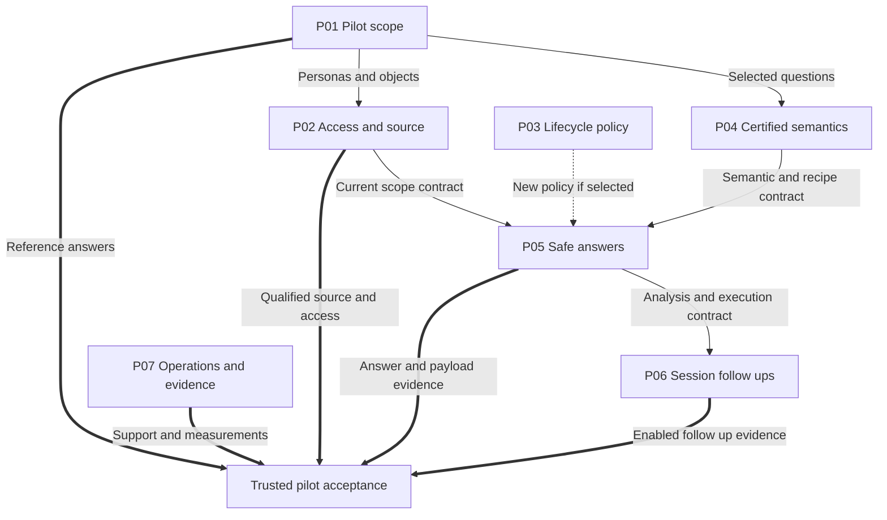

# AskTD Delivery Plans and Dependencies

**Version:** 0.2  
**Prepared:** 22 October 2026, America/Toronto  
**Package edition:** 23 October 2026; portable references only. The proposed version and substantive planning decisions are unchanged.  
**Original portfolio:** Version 0.1, 20 October 2026  
**Status:** Proposed plan portfolio for review and repository reconciliation  
**Purpose:** Turn the agreed Master Plan to Plan to Task framework into a bounded set of delivery plans, explicit output dependencies, and a practical next sequence.

**Continuity note:** This bounded update preserves the original portfolio and its historical planning aliases while applying the later SQL/Databricks baseline and complete phase-lineage clarification. For the current detailed output/dependency schema, read [ASKTD_PLAN_AND_LINEAGE_REFERENCE.md, v0.4](ASKTD_PLAN_AND_LINEAGE_REFERENCE.md). Start a new session with [ASKTD_SESSION_HANDOFF.md](ASKTD_SESSION_HANDOFF.md). These documents do not establish current runtime completion or adoption of the proposed Master copy. [S7–S8]

## 1. Portfolio decision

Use seven near-term plans for the trusted Deposits pilot and eight outline plans for subsequent capabilities. Develop one complete analytical slice first, then expand its supported question coverage. Work may proceed in parallel once the shared contracts for that slice are agreed.

A dependency names the specific output a consumer needs. It does not mean that the entire upstream plan must be completed before any downstream design, implementation, or synthetic testing can start. Release acceptance remains a separate decision over the actual enabled scope.

P01 to P15 are candidate planning keys in this draft. They are not existing GitHub issue numbers, newly assigned engineering phases, or verified implementation statuses. During repository reconciliation, retain existing plan/task identities and link these candidates to them. Assign a new stable issue key only where no owning item exists.

The original portfolio used the 19 October Master Plan revision 2.0 proposal [S1], the 13 October product documents [S2–S3], and the September authorization/alignment records [S4–S5]. The owner accepted the planning framework [S6]. This v0.2 update applies the later provider-baseline and continuity clarification in S7–S8 while preserving the original source history. The live private master, including the previously reported untracked MASTER_PLAN_V2.md, still requires reconciliation in the connected development workspace before this portfolio becomes the execution baseline. No new source, deployment, approval, or completion status is asserted here.

### Preserve the current foundation

- Retain accepted foundation work and the existing Phase 2F.1 classifier, repairs, PRs, tests, and later authorized changes.
- Reuse the historical validated login and App Service SQL identity work and its valid evidence, subject to current scope/revision reconciliation. Missing current repository access does not establish a regression. A new planning structure is not a reason to recreate those repairs or restart a completed investigation; see S8 for the evidence checkpoint.
- Preserve the owner's App Service SQL direction: system-assigned Managed Identity for the workload connection and effective end-user scope enforced by the application. Do not extrapolate that selection to every VM or other service SDK identity.
- Preserve existing scope enforcement and SQL validation. First identify actual gaps in the selected route.
- Keep 2F.1 classification trace-only unless a distinct policy change is accepted. Classification is not the execution approval gate.
- Keep historical engineering phase identifiers. Product releases and engineering phases remain separate attributes.
- Preserve existing authority. Planning and issue creation do not themselves activate features, deploy code, broaden data access, or merge PRs.

### 1.1 SQL and Databricks baseline and staged qualification

SQL and Databricks compatibility is a baseline obligation across the near-term Plans: P01 defines provider coverage and comparable reference cases; P02 supplies compatible application-access semantics and qualified source routes; P04 supplies shared business meaning with explicit provider bindings; P05 supplies provider-aware execution and common result behavior; and P07 records evidence by provider and environment. P15 covers expansion beyond that baseline. This refines the original portfolio's broad provider-to-P15 association. [S7 §§4–5]

One provider may be qualified first for an explicitly selected pilot scope. Qualification of that route does not close the other provider's baseline obligation. Keep separate records for contract design, implementation, adapter verification and live environment qualification. Missing live Databricks access can leave its qualification pending while authorized SQL work or synthetic contract checks proceed. Equal KPI names, successful SQL tests or mocked adapter results do not prove equivalent data or a qualified Databricks connection.

Preserve App Service SQL system-assigned Managed Identity and application-enforced end-user scope. Qualify the actual Databricks host, connector, token route and native workload grants separately; common permissions and semantics do not imply identical provider configuration. Supporting both providers does not authorize cross-provider joins.

## 2. One entry activity

### B0 — Reconcile the current baseline

Perform one bounded reconciliation in the actual development workspace before turning candidate plans into executable tasks.

**Output:** the operative master reference and revision; applicable later decisions; existing plan/task/PR mappings; current repository/branch/HEAD and relevant worktree ownership; and a coverage register for the selected first slice.

For each applicable requirement, record one of: Satisfied, Partial, Missing, Unknown, or Superseded. Attach the existing evidence or a precise description of what remains unknown.

A current review item stays attached to its existing issue or PR. Missing access to a report is not proof that its implementation is missing. Unknowns become bounded verification or decision work only when necessary. Do not rerun historical investigations or tests merely to create a new planning report.

B0 is an entry activity, not a new foundation implementation plan. Its completion means the selected planning baseline is usable; it does not mean every project uncertainty is resolved.

## 3. Dependency meanings

| Kind | Meaning | When it blocks work |
|---|---|---|
| D — Deliverable | A specific definition, decision, or validated output is needed. | Blocks the consumer activity that needs that output. Drafting other parts can continue. |
| C — Contract | Two plans share an interface or behavior contract. | Baseline the contract; then the two sides can proceed in parallel. |
| G — Acceptance gate | Evidence or an accountable decision is required for the enabled capability. | Blocks acceptance or activation of that capability. It need not block authorized synthetic work. |
| O — Conditional | A dependency applies only if a provider, feature, or policy is selected. | Applies only to that selected scope. |

Record the producer, named output, consumer, activity blocked, applicability, evidence, and accountable owner. Do not turn every relationship into an unqualified GitHub "blocked by" edge.

Dependencies concern plan outputs. Avoid apparent cycles such as "instrumentation waits for the application, while the application waits for instrumentation": P07 supplies the event contract early; later it collects measurements from the integrated P05/P06 route.

### 3.1 Transition to the current reference schema

The original tables below retain **D — Deliverable** as a historical dependency label. The current reference uses **H — Required output** for that prerequisite effect. Convert D to H only after retaining the exact consumer activity, applicability and evidence; shared contracts, gates and conditional relationships remain distinct. This is a planning-schema transition, not a rename of a repository Task or engineering phase. [S7 §§3, 7, 10]

The following are examples of alias reconciliation. The complete current named-output inventory is in S7 §6. A legacy bundle may contribute to several current outputs; do not assume a one-to-one replacement or discard its evidence.

| Historical portfolio alias | Current reference relationship | Reconciliation rule |
|---|---|---|
| P01.references | P01.reference_cases | Reuse the actual reference definition/evidence and confirm equal scope |
| P01.acceptance | P01.acceptance_owners, the release/gate matrix and relevant P07.acceptance_bundle content | Split ownership, requirements and acceptance evidence; this is not one automatic rename |
| P02.contract / P02.qualification | P02.scope_contract, P02.sql_route, P02.databricks_route and P02.enforcement_evidence | Resolve each provider/environment and contract-versus-evidence scope separately |
| P04.semantic / P04.relationships / P04.versions | P04.semantic_bundle, P04.relationship_evidence, P04.bindings and P04.publication_contract as applicable | Preserve 2F.3/2F.5 distinctions and actual asset/version identities |
| P05.result / P05.presentation / P05.evidence | P05.result_contract, P05.curated_templates and P05.correctness_evidence, with P05.analysis_contract/P05.adapter_behavior where relevant | Legacy bundled work may span several current outputs |
| P06.context / P06.evidence | P06.context_contract, P06.followup_behavior and P06.context_evidence | Preserve the behavior/evidence distinction |
| P07.contract / P07.measurements / P07.packet | P07.event_contract, P07.metering, P07.support_contract, P07.provider_readiness and P07.acceptance_bundle as applicable | One legacy bundle may supply multiple scoped outputs; P07.feedback is now explicit |
| P08.saved-analysis | P08.saved_analysis | Reconcile the same capability; preserve any existing canonical repository ID |

If an existing repository Task already uses a historical alias, retain its canonical identity and add the current reference link. Never create a duplicate Task merely to normalize an alias.

## 4. Plan inventory

### Near-term plans

| Key | Plan | Concrete outcome | Delivery treatment |
|---|---|---|---|
| P01 | Deposits pilot scope and reference answers | A bounded question/persona/object set with approved definitions, reference calculations, and acceptance ownership. | Define now; start with one representative complete slice. |
| P02 | Application access and governed source route | The selected user/data/source path is supported, authorized, bounded, and qualified. | Reuse current controls and SAMI work; close only evidenced gaps. |
| P03 | Recipe approval and reapproval policy | Explicit policy decisions and, where selected, qualified policy behavior built on the existing classifier. | Decision work can proceed now; new enforcement has its own activation gate. |
| P04 | Certified semantic catalog and required relationships | A versioned semantic/recipe bundle for the selected questions, with evidence for every required relationship. | Keep 2F.3 and 2F.5 as distinct delivery slices. |
| P05 | Safe analytical answers and curated presentation | An authorized question produces a validated, correctly presented answer or a safe, supported failure. | Deliver the first complete analytical route using existing seams. |
| P06 | Clarification and bounded session follow-ups | Users can refine the current analysis without losing meaning or bypassing current access. | Active-session scope only; no dependence on persistent history or preferences. |
| P07 | Pilot monitoring, support, metering, and acceptance evidence | The selected pilot is observable, supportable, measurable, and presented for scoped acceptance. | Define contracts early; collect environment evidence as the route becomes available. |

### Later plans and conditional branches

| Key | Plan | First intended delivery | Required depth now |
|---|---|---|---|
| P08 | Saved work and explicit preferences | Release 2 | Separate contracts for saved analyses, history, and preferences. |
| P09 | Owner templates and controlled publication | Release 2 | Template/reference/publication interfaces and ownership. |
| P10 | Usage administration, showback, and budget controls | Release 2; stronger scheduled-work controls in Release 3 | Outcome, metering dependencies, and business decisions. |
| P11 | Authorized analytical reuse | Conditional optimization, potentially Release 2 onward | Eligibility and measurement conditions; no platform selection. |
| P12 | Scheduled reports and secure subscriptions | Release 3 | Saved-analysis, recipient, freshness, version, and delivery contracts. |
| P13 | Contextual suggestions and reviewed improvement | Release 3 | Authorized candidates and controlled feedback-to-publication flow. |
| P14 | Management reports and controlled exports | Release 4 | Fidelity, export authorization, audit, and size boundaries. |
| P15 | Governed source and metadata expansion beyond the SQL/Databricks baseline | Conditional | One separately justified additional source/integration scope at a time. |

Release numbers preserve the product roadmap [S3]. They do not establish calendar commitments, current readiness, or a technical rule that every plan in one release must finish before design for another release begins.

## 5. Near-term plan definitions

### P01 — Deposits pilot scope and reference answers

**Outcome:** Business, engineering, and QA agree on the same bounded analytical product.

**Scope:** Select supported questions, personas, data objects, metrics, periods, grain, units, authorized dimensions, output expectations, and follow-up depth. Establish reference calculations, data as-of context, tolerances where appropriate, and acceptance responsibility. The 10–15 question patterns in the source roadmap remain a proposal, not a fixed commitment.

**Outputs:**
- P01.scope — selected questions, personas, objects, supported variations, and explicit exclusions.
- P01.references — owner-approved calculations and expected answers, including relevant negative and ambiguous cases.
- P01.acceptance — applicable A01–A10 evidence requirements, owners, workload assumptions, and decision references.
- P01.provider_coverage — explicit SQL and Databricks baseline coverage, first qualification scope and comparable reference-fixture assumptions.

**Dependencies:** B0 identifies the governing scope. Candidate source/object information is developed with P02. Detailed certification uses business/data owner decisions and G08 evidence. One question can be baselined while the remaining question set is still being refined.

**Acceptance:** Every selected question has a meaning, owner, expected result method, allowed scope, and clear unsupported cases. Illustrative figures are not used as approved answers. Open decisions have an accountable function and a stated consequence for the affected slice.

**Exclusions:** Broad domain discovery, unbounded question coverage, and invented delivery dates.

**Proposed lead:** Product/semantics, with Deposits business and data owners and QA. Named accountable people remain to be established.

**Traceability:** S1 §§2–3, 9.3, 10; September D01/D10/D14; A01/A04/A09/A10; G08.

### P02 — Application access and governed source route

**Outcome:** The selected analytical route retrieves only permitted data through the approved workload identity and serving endpoint.

**Scope:** Reconcile the actual login, effective-scope resolution, approved entitlement input, workload identity, approved objects/views, query bounds, network/serving route, freshness, and safe failure behavior. Preserve the existing App Service SQL SAMI direction and valid application-authorization work. Define compatible logical access behavior for SQL and Databricks, with provider-specific route/identity/grant qualification. Examine current enabled-path evidence before proposing changes.

**Outputs:**
- P02.contract — current-scope envelope, approved source/object references, freshness, bounded execution, and deny/unresolved/service-failure semantics.
- P02.qualification — environment-specific source identity, grant, connectivity, access, revocation/freshness, and negative-path evidence for the selected scope, recorded separately for SQL and Databricks. Preserve unknown versus unsupported versus unqualified distinctions.

**Dependencies:** P01 supplies the candidate personas and data objects. P02 and P04 agree on object identifiers; full catalog completion is not required to draft this contract. Operational use depends on the applicable G01/G03/G04/G05 decisions and AUTH evidence. Approved synthetic fixtures remain useful while a real route is unresolved.

**Acceptance:** Authorized cases work; denied or unresolved scope cannot expose protected metadata/data or reach an unauthorized model payload. Missing service access produces a safe source error, without a broader identity or raw-object fallback. Required row/column treatment is evidenced before affected objects are enabled. Query access and permission to transmit a result to a model remain separate checks.

**Exclusions:** Provider user-ACL replication, implicit delegated-user migration, replacement of proven guards, and changes to unrelated VM/SDK identities.

**Proposed lead:** Backend/integrations, with IAM, Data Platform, data owners, network/platform owners, and QA.

**Traceability:** S1 §7; S4; September D03/D04/D17; A02/A03; AUTH-01–AUTH-07 as applicable; G01/G03/G04/G05.

### P03 — Recipe approval and reapproval policy

**Outcome:** Approval evidence and any new execution policy have explicit owners, semantics, and qualified behavior.

**Scope:** Reconcile the 2F.1 baseline and determine approval authority, valid evidence, acknowledgement, reapproval triggers, and expiry/renewal only where actually required. Define REVIEW_REQUIRED behavior before implementing it. Retain dependency-scoped compatibility and the distinction between observational classification and authoritative execution controls.

**Outputs:**
- P03.decision — an owner-backed policy decision table and version/evidence contract.
- P03.policy — the bounded implementation and validation of selected new policy behavior, if required by the adopted scope.
- P03.disposition — the accepted lifecycle mode and evidence for a consuming release: existing execution gate with trace-only classification, or a separately accepted policy change.

**Dependencies:** Existing classifier/recipe evidence and accountable policy-owner decisions. Semantic field and dependency identities are agreed with P04; semantic discovery can proceed in parallel.

**Acceptance:** Missing evidence is not reinterpreted as expiry; an unrelated Registry change does not silently invalidate a recipe; policy states have explicit effects. New enforcement is activated only within its accepted scope. Recorded 2F.1 limitations are retained or addressed through separately justified work.

**Pilot treatment:** P03.policy is not a blanket prerequisite for every pilot route. A06 can be satisfied using the accepted existing gate and trace-only classifier where that is the scoped disposition. The applicable lifecycle decision and evidence are still required.

**Exclusions:** Rebuilding the classifier, retroactively changing historical approval evidence, and inventing policy from model judgment.

**Proposed lead:** Engineering with the accountable content/approval-policy owner; independent review for behavior changes.

**Traceability:** S1 §§4.4, 6.3, 9.2, 10/A06; Phase 2F.2; September D07.

### P04 — Certified semantic catalog and required relationships

**Outcome:** The first pilot questions use an approved, versioned, inspectable semantic/recipe bundle.

**Scope:** Map business meaning to Registry objects, fields, source objects, recipes, versions, provenance, ownership, units, grain, and reference calculations. Keep two named delivery slices:
1. **2F.3 semantic certification:** the minimum approved definitions and recipe references.
2. **2F.5 relationship evidence:** only the relationships required by selected questions, with separate endpoints, keys, cardinality, temporal, and aggregation evidence.

Grouping these outcomes in this portfolio does not merge their engineering identities or change the historical sequence. A question using an already approved route does not require all future relationship work.

**Outputs:**
- P04.semantic — the selected certified semantic/recipe bundle and validation evidence.
- P04.relationships — approved joins and impact evidence for questions that need them.
- P04.versions — stable reference/publication/retirement/rollback compatibility records for curated assets.
- P04.bindings — explicit versioned SQL and Databricks mappings for the selected logical definitions, including physical objects/types and relevant provider restrictions.

**Dependencies:** P01.scope and the relevant business definitions; the P02 source/object contract; applicable approval/version contracts. A bounded manual intake is an option only with owner approval and provenance. Live Collibra integration is not an automatic prerequisite.

**Acceptance:** Definitions reproduce the approved calculations; reference IDs/versions are valid; unsupported or ambiguous mappings fail safely. SQL and Databricks bindings preserve the selected business meaning, units, grain and time interpretation, with evidence scoped to each provider/environment. Required joins do not duplicate measures or mix incompatible periods/grains. Historical D4–D6 prerequisites are referenced with their source namespace and are not confused with September D04–D06.

**Exclusions:** A competing enterprise catalog, guessed joins, mandatory Graph DB, a 500-table onboarding program, and unrestricted cross-source queries.

**Proposed lead:** Product/semantics and engineering, with business/data owners and QA.

**Traceability:** S1 §§6, 9.2; 2F.3 and separate 2F.5 slice; September D02/D07/D10; A01/A04/A06.

### P05 — Safe analytical answers and curated presentation

**Outcome:** The selected approved question produces a correct bounded answer with its analytical context, or a safe and explainable failure.

**Scope:** Integrate approved semantics/recipes, existing scope/query guards, bounded execution, safe model/error boundaries, and deterministic presentation for the selected route. Reuse the current call inventory and source-backed control evidence. Include the proposed 2F.1a error-payload work only if it remains necessary, incomplete, and within authority. Keep required 2F.6 hardening attached to the concrete gap it closes.

**Outputs:**
- P05.result — validated result envelope: metric/version, numbers, units, grain, period, effective scope, warnings, provenance, and as-of information.
- P05.presentation — curated question/output template references, approved deterministic rendering, and version/disable behavior.
- P05.evidence — route-specific correctness, authorization, query, error, payload, and output-validation results for SQL and Databricks separately.
- P05.adapter_behavior — provider-specific dialect, parameter/type, execution-bound, timeout/cancellation and error behavior supporting the common validated result contract.

**Dependencies:** P04's selected semantic/recipe output; P02.contract; P01.references for business acceptance; P07's event/correlation contract. P03.policy is conditional on a selected new policy. Contracts permit parallel work with synthetic results.

**Acceptance:** The approved examples reconcile with reference calculations. Numbers, signs, units, filters, scope, source, as-of, and material warnings remain intact. All enabled model purposes use eligible minimized payloads and bounded attempts. Denied/unresolved/invalid-output cases produce safe outcomes. A safe-error fix does not claim closure of result transmission, history, renderer, or telemetry requirements.

**Conditional routes:** AI formatting requires the specific model/payload/presentation disposition. It is not required for an eligible deterministic route. Retained generated-code visualization needs its own qualified isolation boundary.

**Exclusions:** Full owner authoring UI, persistent history, scheduler, new cache platform, broad framework migration, or unrelated source integrations.

**Proposed lead:** Backend and UX engineering with QA, semantics owners, and applicable security/privacy/model owners.

**Traceability:** S1 §§4.3, 7, 8.2–8.3, 9.2; 2F.4 runtime contracts and bounded 2F.1a/2F.6 where justified; September D03/D05/D09/D12/D15/D16/D17/D18; A02–A05/A07/A08.

### P06 — Clarification and bounded session follow-ups

**Outcome:** A user can refine the current analysis while the application preserves meaning and enforces current access.

**Scope:** Define application-owned analysis context, retain relevant metric/version/period/filter/grain/unit references, apply the requested change, clarify ambiguous input, reset unrelated context on topic change, and isolate sessions/tabs. Reconcile existing clarification behavior on all selected routes, including recipe/template fast paths.

**Outputs:**
- P06.context — bounded analysis-context and clarification contract.
- P06.evidence — follow-up, topic-switch, ambiguity, concurrency/isolation, and current-turn authorization evidence.

**Dependencies:** P04 semantic references, P05 result/execution contracts, and P02 effective-scope behavior. Context/UX design can begin before the full live source route is accepted.

**Acceptance:** Supported follow-ups preserve the intended analysis; ambiguous ones clarify rather than guess. Protected context is reauthorized before use or model transmission. Concurrent sessions cannot overwrite or disclose one another's state. Summaries preserve material dates, filters, units, warnings, and provenance.

**Exclusions:** Persistent conversation history, automatic preference learning, shared history, and schedules.

**Proposed lead:** UX and backend engineering, with Product, QA, and relevant access/privacy owners.

**Traceability:** S1 §§3.5, 8.2, 10; September D05/D06/D18; A02/A05/A07/A08; AUTH-05.

### P07 — Pilot monitoring, support, metering, and acceptance evidence

**Outcome:** The selected pilot has meaningful operational evidence, accountable support, and a complete acceptance packet.

**Scope:** Establish safe correlation, distinct audit/trace/usage records, actual call/attempt metering, feedback, failure visibility, agreed workload/latency/freshness/cost measures, support ownership, and proportionate rollback/disable/recovery evidence. Aggregate business and technical evidence from the other plans without replacing their ownership.

**Outputs:**
- P07.contract — safe event/correlation/metering schemas, retention boundaries, ownership, and failure behavior.
- P07.measurements — observations from the actual integrated route and environment, with source/artifact versions and limitations.
- P07.packet — A01–A10 coverage, open conditions, support/runbook references, and the scoped decision requested from the accountable release owners.
- P07.feedback — a safe path to report an inaccurate answer, with permitted answer/run correlation, controlled access, and a defined support/review route; retain bounded feedback evidence for authorized improvement work.

**Dependencies:** Contract design begins alongside P01/P02. Measurements require the selected P05/P06 route and target environment. Applicable G06/G07/G08/G09 decisions and other release-specific approvals must be recorded or explicitly remain open.

**Acceptance:** Operations can distinguish success, denial, unresolved access, source/model failure, and invalid output; trace a safe correlation reference; and identify actual attempts and measurable cost assumptions. Workload and numerical targets are agreed rather than invented. The evidence packet distinguishes synthetic demonstration, operational pilot, Broad Beta, and production. Record SQL and Databricks capability/environment readiness separately; a successful route does not qualify the other provider. Feedback capture and review must not expose protected answers or another user's activity.

**Enterprise integration:** An approved interim telemetry route may satisfy a scoped contract. Unavailable enterprise integration does not make zero durable evidence acceptable.

**Exclusions:** Implementing every pictured monitoring/event product, formal chargeback, blanket production certification, or repeated full tests for documentation-only edits.

**Proposed lead:** Quality/operations with engineering and accountable business, model, application, and support owners.

**Traceability:** S1 §§8–11; September D10/D11/D12/D14/D18; owns operational evidence for A08–A10 and consolidates A01–A10; G06–G10 as applicable.

## 6. Later plan outlines

These plans remain at outcome/contract depth until the nearer scope and evidence justify task decomposition. Their security, correctness, and operational requirements travel with the feature; those requirements are not deferred to a generic final hardening plan.

### P08 — Saved work and explicit preferences

**Outcome:** Users can retain permitted work and control deliberate personal defaults.

**Separate deliverables:** P08.saved-analysis is a durable approved analysis definition with references and parameters; P08.history is protected conversation reopening and explicit rerun; P08.preferences is inspectable/editable/deletable preference storage with precedence rules. These can be developed and accepted independently.

**Dependencies:** P02 current access and ownership; P04/P05 versioned analytical references; P06.context for conversation-history reuse; agreed purpose-specific persistence, retention/deletion, and consent. History is not a prerequisite for preference controls, and preferences are not a prerequisite for saved analysis.

**Acceptance:** Reopen does not rerun or incur silent query/model work; current access is checked before display/reuse; explicit rerun uses current permissions and freshness; preferences cannot grant access or change meaning; deletion removes reuse while required audit retention remains accurately described.

**Outside scope:** Inferred permanent preferences without confirmation or a mandatory owner-authoring UI.

**Lead / mapping:** UX/backend with privacy and data owners; Release 2; September D06/D17/D18; A02/A05/A07/A08/A10, AUTH-05.

### P09 — Owner templates and controlled publication

**Outcome:** Content owners author parameterized questions/layouts from already approved analyses and publish reviewed versions.

**Dependencies:** P04 semantic/recipe references, P05 template/result contracts, and the applicable P03 approval/version policy. Maker-checker authority and publication/rollback rules must be explicit. Minimal curated publication needed by P04/P05 exists in their own scope; this later UI is not a Release 1 prerequisite.

**Acceptance:** Preview reconciles with references; templates cannot redefine metrics or grant data access; approved versions can be published, retired, rolled back, or disabled; compatible references and current authorization remain valid.

**Outside scope:** Full Metadata Admin Studio, 500-table scale, uncontrolled semantic editing, or self-publishing generated templates.

**Lead / mapping:** Product/semantics and UX/backend with content approvers; Release 2; 2F.4 authoring and provisional 2G forward reference; September D02/D07/D09; A02/A04/A06–A08.

### P10 — Usage administration, showback, and budget controls

**Outcome:** Authorized administrators understand and control product capability usage and its cost.

**Dependencies:** P07 metering/attribution and P02 administrative authorization; agreed allowance, allocation, price-version, reconciliation, and limit behavior. Scheduled-work limits are an input to P12 when that feature is selected.

**Acceptance:** Attempts/failures are included; missing measurements are unknown rather than zero; estimated usage cost and reconciled charges are distinct; shared cost allocation is explicit; limits cannot weaken access or silently change answer quality. Subscription entitlements never grant data rights.

**Outside scope:** Mandatory payment processing or formal chargeback. Those require a separate Finance-approved scope.

**Lead / mapping:** Operations/product/backend with Finance for financial decisions; Release 2 and expanded Release 3 budgets; September D11/D14/D17; A02/A08–A10.

### P11 — Authorized analytical reuse

**Outcome:** Measured eligible repetition becomes cheaper or faster without weakening meaning, access, or freshness.

**Separate mechanisms:** Early request/template reuse uses pre-plan identity; post-plan reuse may use semantic-plan/recipe/dependency identity. Select the object being reused: plan, bounded result, or final response.

**Dependencies:** P02 current scope/freshness; P04/P05 semantic, recipe, output, and version identities; P07 measured baseline. Saved conversation history, Redis, and a new materialized-data platform are not required inputs.

**Acceptance:** No early-key requirement for semantic_plan_hash; isolation and revocation behavior are proven; incompatible/stale entries cannot silently serve; a miss does not change lifecycle approval; failure/disable behavior and measured benefit are accepted.

**Lead / mapping:** Backend with QA/operations and data/access owners; conditional optimization; September D08 with D03/D06/D14; A02/A04/A07/A09/A10.

### P12 — Scheduled reports and secure subscriptions

**Outcome:** An approved saved analysis can run on a controlled schedule and be delivered through a secure report link.

**Dependencies:** A saved-analysis definition (P08.saved-analysis or a validated equivalent already present), approved published content/version compatibility (P04/P05 curated path or P09), P02 owner/recipient/viewer authorization, P07 report-run/delivery evidence, and the required P10 budget policy. Full history, preferences, authoring UI, formal billing, and exports are not prerequisites.

**Acceptance:** Check the owner's scope before execution, recipients before delivery, and viewers on opening. Verify timezone/DST, reporting-period calculation, freshness, version changes, retries/idempotency, missed runs, pause/cancel, and owner departure. Invalid or stale results follow an approved visible policy. Run status and delivery status are distinguishable.

**Lead / mapping:** Backend/UX and operations with content/access owners; Release 3; S1 §3.6; September D03/D06/D14/D17/D18; applicable A02/A04/A07–A10.

### P13 — Contextual suggestions and reviewed improvement

**Outcome:** Users discover relevant permitted analyses and owners receive evidence-backed improvement proposals.

**Dependencies:** P04 authorized catalog and P06 context for context-based suggestions; P07.feedback and permitted aggregate usage evidence for feedback-based improvement; and an approved publication route for accepted improvements. P08.preferences is required only for preference-based suggestions.

**Acceptance:** Suggestions disclose no unauthorized candidates and do not execute queries on display; their basis is clear. Aggregation does not expose other users' protected content. Improvement proposals are reviewed and released through the content process, rather than rewriting production meaning.

**Lead / mapping:** Product/semantics, UX, and engineering; Release 3; September D02/D05/D06/D09/D11/D12/D18; A02/A05/A07/A08/A10.

### P14 — Management reports and controlled exports

**Outcome:** Approved analyses form consistent multi-section reports and controlled Excel/PDF outputs.

**Dependencies:** P04/P05 versioned analyses and validated output, P02 export scope, P07 mandatory export audit, and approved distribution/retention/size policies. P12 is needed only if the report is also scheduled.

**Acceptance:** Numbers, grain, units, filters, periods, sources, and as-of context remain consistent across sections/chat/charts/export; hidden or unauthorized data is excluded; the required audit exists before export; volume and failure behavior are bounded. Do not promise revocation of every downloaded copy.

**Lead / mapping:** UX/backend with QA, data/security owners, and operations; Release 4; September D02/D09/D10/D14/D17/D18; applicable A02/A04/A07–A10.

### P15 — Governed source and metadata expansion

**Outcome:** A selected source, domain or metadata integration beyond the required SQL/Databricks baseline works through the established protected, provider-neutral contracts. Baseline SQL/Databricks compatibility belongs to P01/P02/P04/P05/P07 even when environment qualification is staged.

**Dependencies:** A specific business need; P02 source/access and P04/P05 semantic/execution contracts; provider-specific owner decisions, identity/grants, serving endpoint, dialect, freshness, performance, and failure qualification.

**Acceptance:** Semantic and authorization parity hold; object mappings are approved; query pushdown, timeout/cancellation, concurrency, source load, rollback, and monitoring match the selected workload. Metadata integration has provenance, mapping, refresh, publication, and failure rules.

**Outside scope:** Reclassifying baseline SQL/Databricks compatibility as optional expansion, automatic cross-source joins, implicit Genie adoption, or unbounded schema onboarding. An explicitly scoped pilot may qualify one route first without closing the remaining baseline obligation. Split genuine expansion by provider/use case if independent delivery warrants it.

**Lead / mapping:** Backend/integrations, semantics, Data Platform and governance; conditional; September D04/D13/D15/D17/D18; source-specific A gates. Preserve historical provider-phase cross-references rather than renumbering.

## 7. Main dependency map

The diagram shows selected output relationships. It is not a claim of current readiness or an exhaustive deployment dependency graph.

- Solid arrow: the named definition/contract output is required for the consuming integration.
- Dotted arrow: conditional policy contract.
- Thick arrow: evidence contributes to pilot acceptance.
- Shared contract work and synthetic tests can start before the corresponding operational gate closes.

P07.contract is designed early and consumed by P05/P06. P07.measurements is produced later from those integrated routes. Both are deliberately represented in text rather than as a misleading plan-level cycle.

P03.disposition supplies the applicable A06 evidence. Full new 2F.2 policy enforcement is required only if the selected scope needs it. Required relationship evidence from P04 is a gate for the questions using those relationships.

### Detailed dependency register

| Consumer | Required output | Kind | What is blocked until satisfied |
|---|---|---|---|
| P02 | P01 selected personas/objects | D/C | Final qualification of those specific scopes; generic contract review can proceed. |
| P04 | P01 approved definitions and P02 object-reference contract | D/C | Certification of the selected bundle. |
| P04 relationship slice | Evidenced fields, endpoint datasets, naming, grain and temporal semantics | D/G | Use of the specific new join. |
| P03 policy implementation | P03 owner-backed decision and existing classifier/evidence contract | D | Implementation of the undecided policy. |
| P05 | P04 selected semantic/recipe output and P02 access/source contract | D/C | Integrated acceptance of that analytical route. |
| P05/P06 | P07 safe event/correlation contract | C | Final instrumentation integration, not standalone domain tests. |
| P05 new-policy route | P03 selected policy and activation evidence | O/G | Activation of the new policy-dependent route. |
| P06 | P04 semantic identity, P05 analysis/execution contract, P02 current access | C | Integration and acceptance of protected follow-ups. |
| P07 measurements | Selected integrated P05/P06 route and P02 target environment | D | Claims about observed operational behavior. |
| R1 gate | P01 references, P02 qualification, P04/P05/P06 applicable evidence, P03 disposition, P07 packet | G | Operational pilot acceptance for that scope. |
| P08 history/saved analysis | P02 current access, P04/P05 references, persistence and retention decisions | D/C/G | Acceptance of protected persistence and reuse. |
| P08 preferences | User control, precedence, consent and storage/retention contracts | D/C/G | Preference persistence; history completion is not required. |
| P09 | P04 approved references, P05 template/result contract, applicable publication policy | D/C/G | Publication by content owners. |
| P10 | P07 metering/attribution, P02 admin access, business limit rules | C/G | Accepted administration, showback, and limits. |
| P11 | P02 scope/freshness, P04/P05 versions, P07 performance/cost baseline | D/G/O | Reuse activation and a claim of benefit. |
| P12 | Approved saved-analysis definition and published compatible content | D | Resolving a schedule to a stable approved analysis. |
| P12 | P02 owner/recipient/viewer checks, P07 delivery evidence, required P10 limits | C/G | Operational scheduling and delivery. |
| P13 | P04 authorized candidates, P06 relevant context; P07.feedback and permitted aggregate evidence for feedback-based improvement | C/G | The corresponding mode only; feedback is required for feedback-based improvement, not every suggestion. |
| P13 personalization | P08 explicit preference contract | O | Only preference-based suggestions. |
| P14 | P04/P05 validated output, P02 export access, P07 export audit | C/G | Export/report acceptance. |
| P14 scheduled variant | P12 accepted scheduling/delivery contract | O | Only scheduled delivery of that report. |
| P15 | Selected provider use case and P02/P04/P05 contracts with provider qualification | D/G/O | Activation of that additional route. |

### Relationships that must not be added by default

- Full P03 completion before any semantic design or pilot work.
- Full enterprise catalog integration before a permitted bounded manual semantic intake.
- Completion of the other provider's live qualification before accepting an explicitly scoped existing route; the remaining SQL/Databricks baseline obligation stays open and visible.
- Full owner-authoring UI before curated, versioned pilot templates.
- Persistent history or preferences before active-session follow-ups.
- Full history/preferences/authoring UI before a valid saved-analysis scheduling contract.
- Scheduler completion before interactive management reports or exports.
- Cache implementation before a usable pilot, unless a specific accepted workload decision makes that solution necessary.
- Completion of every historical operations phase before the bounded operational evidence needed now.

## 8. Engineering and requirement traceability

### Broad Master phases 0–7

These are the original Master engineering namespaces from S1 §9.1. Plan associations below are proposed delivery mappings, not claims that a phase is implemented or closed. A Plan can contribute to several phases, and a phase can feed several Plans. [S7 §4]

| Master phase | Portfolio relationships | Preserved scope and bounded treatment |
|---|---|---|
| 0 — Secure foundation and governance | Retained baseline supporting P02/P07 | Reuse accepted login, protected-route, security, test and rollback evidence; reopen only evidenced current defects |
| 1 — IAM, SpruceX and deployment alignment | P02 and P07 qualification/ownership evidence | Identity/registration, entitlement inputs, workload grants, networking, environment boundaries and build/run ownership |
| 2 — Registry and semantic foundation | P03/P04/P05/P09 | Actual 2F slices, approved definitions, provenance, templates and controlled publication |
| 3 — Authorization, audit, quality and safe execution | P02/P05/P06/P07; applicable controls follow later protected features | Effective access, row/column treatment, bounded execution, business evaluation, payload/renderer controls and isolation |
| 4 — SQL Server and Databricks scale | Baseline P02/P04/P05/P07, with P01 provider coverage; P15 further expansion | Provider bindings/adapters, identity/dialect behavior, execution bounds, freshness, concurrency and qualification |
| 5 — Model governance, usage and observability | P07/P10 and relevant P05 model boundaries | Actual-call inventory, policy, metering, attribution, tracing, showback and separately approved chargeback |
| 6 — Governed self-service | P09 with related P04/P13/P15 outputs | Owner authoring, controlled publication, reviewed improvement and later metadata administration/onboarding |
| 7 — Operations and adoption | P07 plus operational requirements of every released Plan | Support, monitoring, SLOs, recovery, release/rollback, retention, capacity and cost/value evidence |

Minimum applicable access, observability and support controls accompany the pilot; broader later phase labels do not defer those requirements.

### Phase namespaces must remain distinct

The executive **Phase 1 / Phase 2 / Phase 3** presentation in `Roadmap-onepager.md` is a separate namespace from the original Master engineering Phases 0–7, detailed 2F slices, product releases R1–R4 and P01–P15 delivery aliases. Matching numerals do not establish equivalent scope or completion. Carry the source document and namespace with each reference and reconcile mappings by actual requirement/output.

Later handoffs also use provider **Phase 3** where the original Master uses **Phase 4**. Preserve those source-specific references until actual task anchors are reconciled; do not renumber accepted phases, branches or Tasks to make them appear consistent.

### Detailed engineering phases and aliases

| Existing identity | Portfolio owner | Preservation rule |
|---|---|---|
| 2F.1 | Existing baseline linked to P03 and A06 | Preserve current work and evidence; no duplicate classifier plan. |
| Proposed 2F.1a | P05, only if still necessary and authorized | Separate safe error-payload closure from other model-use gaps. |
| 2F.2 | P03 | Owner decision before new policy behavior. |
| 2F.3 | P04 semantic slice | Business-approved meaning and versioned runtime representation. |
| 2F.4 | P05 runtime/presentation; P09 authoring | Keep curated rendering, owner UI, persistence and export scopes explicit. |
| 2F.5 | P04 relationship slice | Preserve its distinct evidence prerequisites and source namespace. |
| 2F.6 | P04/P05/P07 as relevant | Each hardening item belongs to a demonstrated requirement; no unlimited catch-all. |
| 2G forward reference | P09 and the curated publication contracts | Provisional label; map to the actual repository definition. |
| Provider phases with historical numbering differences | Baseline P01/P02/P04/P05/P07; P15 beyond baseline | Preserve source namespaces and qualify each provider/environment; do not renumber branches or accepted phases. |

### September architecture deltas

| Requirement | Primary plan or constraint |
|---|---|
| D01 Deposits scope | P01 |
| D02 Runtime semantics and enterprise ownership | P04, consumed by P05/P09/P13/P14 |
| D03 Application authorization and MI | P02, applied at every protected feature boundary |
| D04 Governed source route and compute | P02/P04/P05/P07 baseline; P01 coverage; P15 further expansion |
| D05 Clarification | P05/P06; P13 where suggestions are involved |
| D06 Bounded context and later persistence | P06/P08/P12/P13 |
| D07 Lifecycle compatibility | P03/P04; P09 publication |
| D08 Early and post-plan reuse | P11 |
| D09 Deterministic presentation | P05/P09/P14 |
| D10 Business evaluation | P01/P04/P05/P07 |
| D11 Observability | P07/P10 and each feature's event coverage |
| D12 Model inventory and MRM | P05/P07 |
| D13 Conditional integrations | P15; no automatic pilot dependency |
| D14 Ownership and economics | P01/P07/P10; applicable scheduling/expansion scope |
| D15 Framework and gateway reconciliation | P05/P07/P15; preserve existing framework until a distinct decision |
| D16 Complete responses and optional ingestion | Constraint on P05/P15; not a mandatory new implementation plan |
| D17 Protected APIs and storage purposes | P02/P05/P07/P08/P10/P12/P14/P15 |
| D18 Error/result/history/output/trace boundaries | P05/P06/P07/P08 and later protected feature routes |

AUTH-01–AUTH-07 remain the existing authorization requirements [S4]. A01–A10 remain pilot acceptance gates [S1 §10]. Do not create competing numbered requirements or use this mapping as proof that any gate is complete.

## 9. Release acceptance

### R1 — Trusted Deposits pilot

The minimum accepted slice includes:
- P01.scope and business reference answers.
- A qualified P02 route and effective-access behavior for the enabled data.
- The P04 semantic bundle and any relationships actually used.
- P05 safe answers and eligible presentation/model behavior.
- P06 clarification/follow-ups to the agreed bounded depth.
- The applicable P03 lifecycle disposition; new policy only where selected.
- P07 operational measurements, support, safe answer feedback, and the A01–A10 evidence packet.
- Explicit SQL/Databricks coverage and separate provider/environment readiness; any first-route-only pilot disposition leaves the other baseline obligation visible.
- Applicable scoped data, architecture, privacy, security, model, and operational decisions.

Without the required real-data/source authorization, a synthetic end-to-end demonstration remains valid engineering progress. It must be labelled as that demonstration rather than an accepted operational pilot. A reduced feature scope requires an explicit scope decision; missing mandatory controls cannot be treated as passed.

### R2 — Everyday use

Accept the selected P08 saved-work/preferences scope, P09 owner templates/publication, and P10 usage administration. Carry forward and extend access, retention, fidelity, support, and evidence coverage for every enabled feature. P11 reuse remains conditional.

### R3 — Recurring value

Accept P12 scheduling/secure delivery, selected P13 suggestions/improvement, and the required P10 scheduled-work budgets. Use the minimum accepted saved-analysis and content-version contracts; full unrelated UI completion is not a gate.

### R4 — Management reporting and controlled expansion

Accept the selected P14 report/export scope and its updated capacity, support, audit, and cost evidence. P15 is conditional on an approved additional source or integration; it is not automatically required for R4.

Broad Beta and production retain their own scope-specific gates in S1 §§10.2–11. Release numbering, a green workflow, a closed issue, or a merged PR does not substitute for those decisions.

## 10. External decisions and limited blocking scope

The source records list the dependencies below. Their current resolution must be checked against current owner evidence; this portfolio does not assert that all remain unresolved.

| Existing reference | Required decision/evidence | Plans affected | Narrow consequence |
|---|---|---|---|
| G01 / AUTH-01 | Entitlement authority, namespace, maintenance and revocation contract | P02 and protected consumers | Blocks affected real-user/data access. |
| G02 | Enterprise metadata coverage and integration contract | P04/P15 | Blocks the selected live integration; an approved manual intake may be sufficient for a bounded scope. |
| G03 | Approved objects, route, treatment, query/copy and freshness | P02/P04 | Blocks use of the unapproved route. |
| G04 | Serving endpoint and workload/latency/concurrency/cost evidence | P02/P07 | Blocks operational acceptance of that workload. |
| G05 / AUTH-02 | Actual workload identity, grants, network and deny evidence | P02 | Blocks activation of that provider/environment route. |
| G06 | Model/use-case ownership and assessment scope | P05/P07 | Blocks the affected model use or acceptance claim. |
| G07 | Application/build/run/support ownership and funding | P07/P10 | Blocks the corresponding operational handover or commitment. |
| G08 | Business reference questions/calculations and acceptance ownership | P01/P04/P07 | Blocks business acceptance of those analytical outcomes. |
| G09 | Supported observability path, permitted content, retention and durability | P07 | Blocks unqualified telemetry integration; an accepted interim evidence path must still satisfy the needed contract. |
| G10 | Separate pilot-to-production decision | All released plans | Blocks production release, not unrelated planning or synthetic work. |
| G11 | Diagram/runtime/framework/gateway disposition | P05/P07/P15 | Blocks only the selected unresolved integration/change. |

Feature-specific decisions are taken before they are needed: retention/consent for P08; creators/approvers for P09; budget rules for P10; eligible objects/freshness for P11; recipient/channel/DST/owner-departure policy for P12; distribution and export controls for P14; source selection for P15.

A proposed owner function is not an assigned person or a verified GitHub team. Record actual accountable people and access when plans are adopted.

## 11. Deliberate next sequence

### Step 1 — Complete B0 once

Adopt the actual master revision and later decisions, map existing work, and identify what is already satisfied for the first slice. Keep the current PR/review process attached to its existing record.

**Exit:** A usable baseline and a bounded set of genuine unknowns.

### Step 2 — Choose one representative analytical slice

Use P01 to select one approved Deposits question with a reference calculation, its personas and objects, and the intended bounded follow-up. If real-data approval is unavailable, use a clearly labelled synthetic engineering slice while the business definition is prepared.

**Exit:** A concrete scope that P02/P04/P05/P06/P07 can all reference.

### Step 3 — Baseline the contracts in parallel

Advance P01 business definitions, P02 access/source contract, P03 relevant policy decisions, and P07 safe events/support requirements. P04 prepares the selected semantic bundle; P05 and P06 define the result and analysis-context contracts for that slice. This is parallel contract design, not a requirement to finish P05/P06 implementation before proceeding. Resolve shared contract ownership before concurrent edits.

**Exit:** The required source-object, effective-scope, semantic/result, analysis-context, and event contracts for that slice.

### Step 4 — Decompose only the next executable work

For the selected slice:
- Satisfied requirement: link evidence.
- Existing work in progress/review: link its current issue/PR.
- Proven gap: define a bounded implementation task including its tests.
- Necessary unknown: define a bounded verification task.
- Required undecided policy: define a decision task with a clear owner and output.

**Exit:** A small, reviewable set of Ready or explicitly Blocked tasks with no duplicate work. Do not decompose all 15 plans into detailed tasks at once.

### Step 5 — Produce the GitHub creation preview

Map parent plans and tasks to existing identities. Show Create / Update / Link existing / No change / Conflict, required relationships, and field ownership. Retain human discussion and current status. A repeat run over the same input must not create duplicate issues.

**Exit:** A concrete publication batch. Publishing plans is separate from executing lifecycle/snapshot/deployment workflows.

### Step 6 — Prove the slice, then expand

Complete synthetic/integration evidence, then qualify the actual authorized route and present the applicable pilot acceptance packet. Reuse valid earlier evidence and broaden testing only for a concrete risk or required gate. Expand question coverage before adding unnecessary platforms or independent features.

**Exit:** A supported, observable answer workflow with clear remaining conditions. Use measured results to decide whether later priorities are saved work, authoring, reuse, or another justified capability.

## 12. Planning controls for adoption

- Existing repo plans and task IDs take precedence over creating parallel records.
- Keep scope/architecture in the canonical master/ADR/plan location; current owner/status/dependencies and PR links belong in GitHub once adopted.
- Store accepted evidence with its source revision, environment, observation date, and run/artifact link.
- For execution tasks, separate workflow definition ref, checked-out/tested source SHA, built artifact, and deployed version.
- One active implementation owner per task; coordinate overlapping shared-contract edits. A separate worktree does not remove semantic conflicts.
- Preserve dirty changes owned by other tasks. Record a concise continuation checkpoint rather than resetting the workspace.
- "Done" follows the task's agreed deliverable. Code delivery, environment qualification, plan acceptance, and production release are distinct outcomes.
- Later plan outlines remain Draft until their scope, decisions, dependencies, and owners justify task readiness.
- Numerical deadlines, workload targets, prices, and staffing commitments require actual owner/capacity evidence.

## 13. Source register

Package documents are linked locally. S4–S5 identify application reference evidence that is not bundled; locate their operative versions or accepted successors during repository reconciliation. S6 records owner direction, not a claim of current implementation.

**S1 — Master Product and Delivery Plan.** [MASTER_PLAN_V1(2).md](<MASTER_PLAN_V1(2).md>), document ID MASTER_PLAN_V1; original reviewed revision 2.0 proposed consolidated update, 19 October 2026; current revision 2.1 proposed, 22 October 2026. Relevant sections: §1 authority/evidence; §§3–8 product/architecture/contracts; §9 delivery; §§10–11 acceptance; §§13–14 decisions/continuation; Appendix B D01–D18; Appendix D adoption; Appendix E continuity. Neither proposal establishes adoption by the application repository; resolve the operative revision through S8.

**S2 — Product Definition.** [AskAlpha Product Definition](PRODUCT_DEFINITION_EN.md), original reviewed version 1.1, 13 October 2026; package version 1.2, 22 October 2026, with baseline-provider and continuity clarification. The document revision identifies planning content, not an application deployment.

**S3 — Quarterly Product Roadmap.** [AskAlpha Quarterly Product Roadmap](QUARTERLY_PRODUCT_ROADMAP_EN.md), original reviewed version 1.1, 13 October 2026; package version 1.2, 22 October 2026, with baseline-provider and continuity clarification. Four delivery quarters from the agreed team start; dates and capacity remain proposed.

**S4 — Authorization Decision Record.** AskTD_02_Authorization_Decision_Record_2026-09-10.md; updated 14 September 2026, version 0.2. Application effective-scope enforcement, Managed Identity source access, no provider ACL replication, AUTH-01–AUTH-07 and explicit enterprise authority boundaries.

**S5 — Phase 2F Alignment Prompt.** askalpha_Phase_2F_Alignment_Prompt_2026-09-14.md. Preserve accepted progress and user changes; reconcile the live impact matrix; distinguish historical source findings from current runtime evidence; retain detailed 2F slices and bounded continuation.

**S6 — Original owner direction.** The owner accepted the Master Plan → Plan → Task → GitHub framework and requested plan design and dependency visibility before further execution. The existing App Service SQL SAMI/application-authorization direction and previously granted task authority remain applicable within their scope.

**S7 — Current delivery and lineage reference.** [ASKTD_PLAN_AND_LINEAGE_REFERENCE.md](ASKTD_PLAN_AND_LINEAGE_REFERENCE.md), v0.4 continuity update, 22 October 2026. Use its full phase crosswalk, named outputs, typed dependencies and task contract for new planning artifacts. Its source mappings remain subject to operative repository reconciliation.

**S8 — Session continuation checkpoint.** [ASKTD_SESSION_HANDOFF.md](ASKTD_SESSION_HANDOFF.md), 22 October 2026. Records the documentation baseline, unresolved runtime evidence and the next bounded activity. Documentation availability is not evidence of implementation or release acceptance.

The plan grouping, candidate keys, named outputs, dependency classifications, and sequence in this portfolio are proposed delivery design derived from these sources. They require reconciliation with the actual current plan and issue records before operational adoption.

## 14. Change history

| Version | Date | Change and limits |
|---|---|---|
| 0.1 | 20 October 2026 | Original proposed P01–P15 portfolio, output dependencies and bounded next sequence |
| 0.2 | 22 October 2026 | Preserves the original portfolio; corrects baseline SQL/Databricks allocation, staged qualification and P15 boundaries; adds full Master phases 0–7, namespace clarification, explicit P07.feedback, legacy alias/schema transition and continuation links. No new runtime, approval or completion status is asserted |

